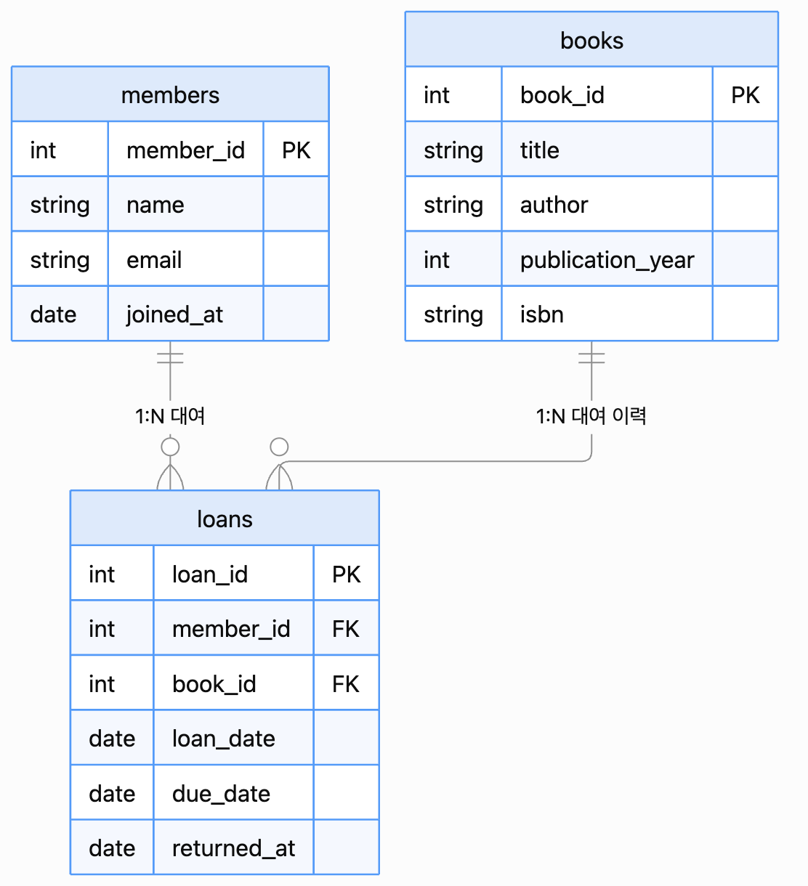
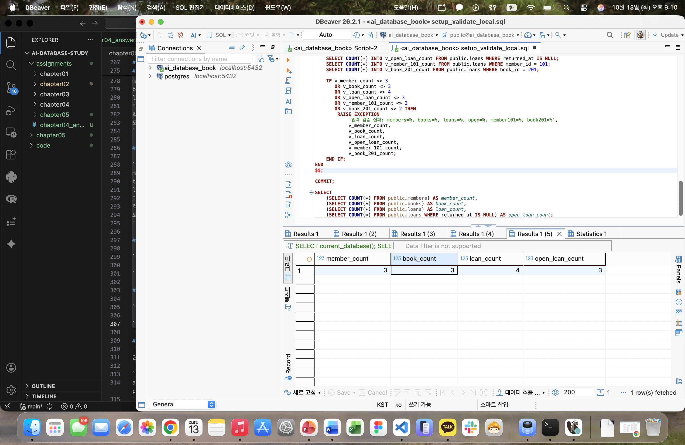
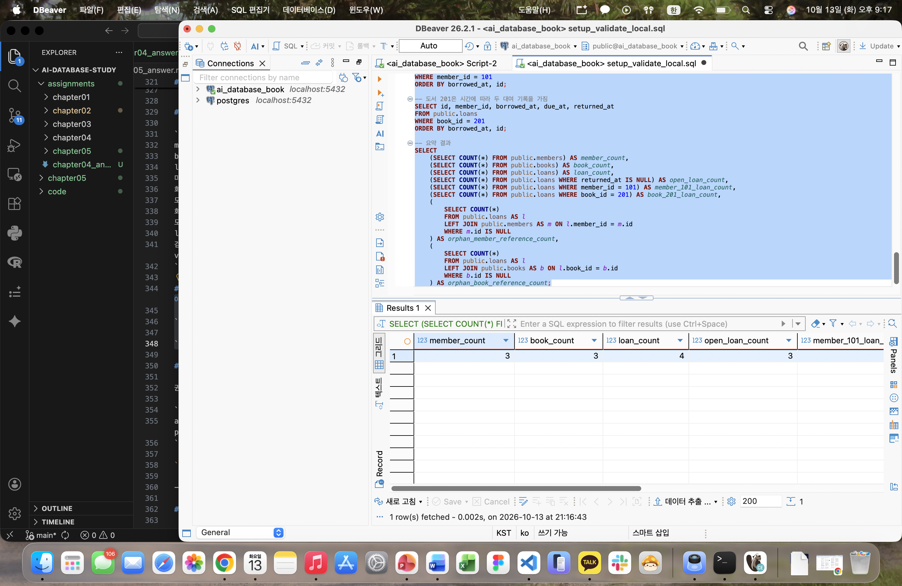
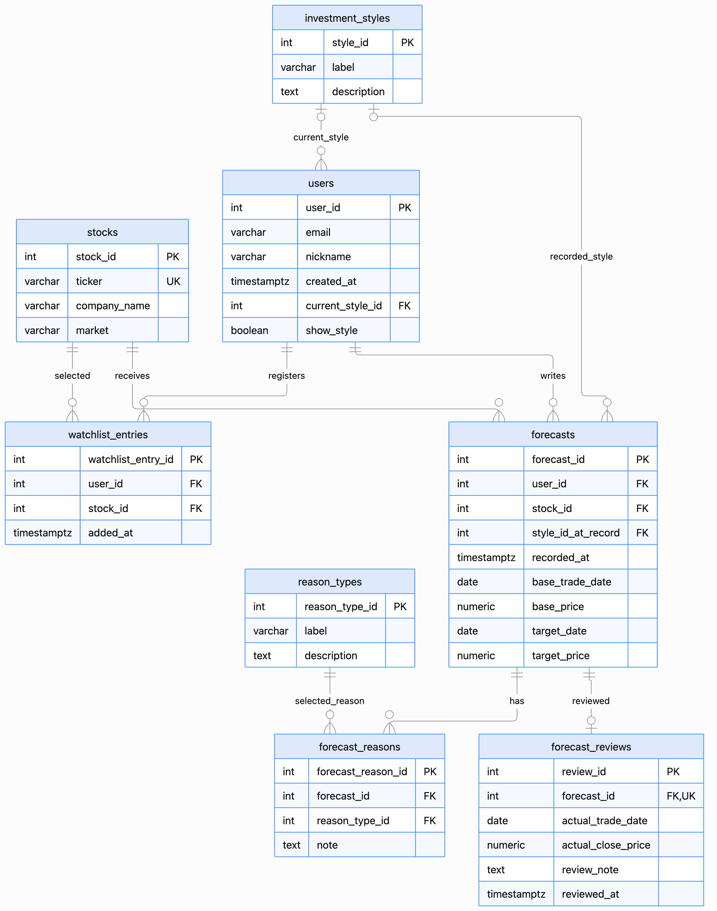

# Chapter 05 확장 실습 답안 템플릿

> **과제:** 요구사항에서 데이터 모델과 ERD 만들기  
> **사용 방법:** 이 파일을 내려받아 본인의 GitHub 저장소에 `chapter05_answer.md`라는 이름으로 저장한 뒤 실습하면서 바로 작성합니다.  
> **제출 방법:** LMS에는 파일을 직접 업로드하지 않고, **본인 GitHub 저장소의 `chapter05_answer.md` 파일 URL**을 제출합니다.

---

## 제출 전 주의

이 파일과 캡처 화면에는 실제 비밀번호, 전체 DB 접속 URL, API Key, 개인정보를 기록하지 않습니다.

```text
GitHub 계정 또는 별칭: gosaengchung
과제 작성일: 2026-10-13
사용한 AI 도구: GPT Sol
```

---

# 1. Chapter 05 핵심 개념 복습

본문을 보지 않고 먼저 작성합니다.

```text
요구사항에서 바로 테이블부터 만들면 위험한 이유: 필요한 데이터와 업무 규칙을 충분히 파악하기 전에 테이블을 만들면, 누락이나 중복이 생기고 나중에 update 과정이 복잡해짐

한 행의 의미를 먼저 정해야 하는 이유: 한 행이 무엇을 나타내는지 명확해야 테이블 간 중복된 행이나 집계를 막을 수 있음

확정 요구사항과 미확정 정책을 구분해야 하는 이유: 확정된 내용은 설계에 반영하고, 미확정 내용은 임의로 결정하지 않고 확인할 수 있도록 남겨야 잘못된 가정을 줄일 수 있음

PK와 업무상 고유값 후보의 차이: PK 값은 데이터베이스 상에서 행을 구분하는 장치이고, 업무 상 고유값은 실제 업무 과정에서 구분하려고 하는 자연어 내지 업무어임

N:M 관계를 그대로 두지 않고 연결 테이블을 검토하는 이유: 관계 양쪽의 여러 데이터를 직접 연결하면 한 칸에 여러 값을 넣거나 중복이 생길 수 있음. 따라서 연결 테이블로 관계를 분리하면 각 연결을 한 행으로 관리하고, 관계 자체에 필요한 정보도 저장할 수 있음
```

---

# 2. 도서 대여 요구사항 R-01~R-07 다시 분해

| 요구사항 | 관리 대상 / 사건 | 속성 후보 | 관계 / 규칙 후보 | 미확정 질문 |
| --- | --- | --- | --- | --- |
| R-01 | 회원 | 회원 식별 정보(PK) | 도서관이 회원 정보를 관리한다. | 회원은 도서관별로 구분되는가? |
| R-02 | 회원 | 이름, 이메일, 가입일 | 한 회원은 하나의 이름, 이메일, 가입일을 가진다 | 이메일은 필수인가? |
| R-03 | 도서 | 제목, 저자, 출판연도, ISBN | 한 도서 행에는 제목과 저자, 출판연도, ISBN 정보가 존재한다 | 어떤 게 필수값인지? |
| R-04 | 대여 | 회원, 대여 대상 도서 | 회원 한 명이 여러 도서를 대여할 수 있다. | 대여 권수에 제한이 있는지? |
| R-05 | 대여 이력 | 도서, 대여 시점별 기록 | 한 도서는 시간에 따라 여러 번 대여될 수 있다. 도서와 대여 기록은 1:N 관계일 수 있다. | 같은 도서가 동시에 여러 회원에게 대여될 수 있는가? |
| R-06 | 대여 기록 | 대여일, 반납예정일, 실제반납일 | 각 대여 기록에 대여 및 반납 관련 날짜를 저장한다. |  |
| R-07 | 미반납 대여 기록 | 실제반납일 | 아직 반납되지 않은 대여 기록은 실제반납일이 비어 있을 수 있다. | 미반납과 반납을 구분하는 속성키가 따로 있는지? |

### 본문과 비교한 뒤 수정한 내용

```text
처음에 놓친 부분: 한 도서에 저자가 여려명일 수 있는지?

처음에 잘못 분류한 부분: R-01의 ‘회원 식별 정보(PK)’를 속성 후보로 적은 점

수정한 이유: R-01은 도서관이 회원을 관리한다는 내용만 제시함. 따라서 회원을 식별할 필요는 있지만, 어떤 값을 PK로 사용할지는 요구사항에 명시되지 않았으므로 PK로 표기를 미리해선 안됨
```

---

# 3. 확정 규칙과 미확정 정책 구분

## 3-1. 확정된 규칙

```text
1. 회원과 도서를 관리한다.
2. 대여 기록은 회원과 도서를 연결한다.
3. 대여일과 반납예정일을 저장한다.
4. 한 회원과 한 도서는 시간에 따라 여러 대여 기록을 가질 수 있다.
5. 실제반납일은 비어 있을 수 있다.
```

## 3-2. 미확정 질문

최소 5개를 작성합니다.

```text
Q1. ISBN은 반드시 고유한가?
Q2. ISBN 혹은 저자가 없는 도서를 등록할 수 있는가?
Q3. 회원 한 명의 최대 대여 권수는?
Q4. 같은 ISBN을 가진 도서가 여러 권이라 동시에 여러 회원에게 대여될 수 있는가?
Q5. 한 도서에 저자가 여러 명일 수 있는가?
```

### 미확정 정책을 바로 `UNIQUE`, `CHECK`, 삭제 규칙으로 구현하면 위험한 이유

```text
위의 ISBN 코드와 같이 아직 조건을 정하지 않은 채 UNIQUE, PK 등의 규칙으로 구현할 시 실제 정책과의 괴리가 생길 수 있고, 이후 UPDATE 및 변경이 매우 어려워져 새롭게 데이터베이스를 구축해야할 부담이 있음
```

---

# 4. 엔터티·속성·사건 후보 구분

| 후보 | 대상 엔터티 / 사건 엔터티 / 속성 | 판단 근거 | 독립 식별 필요? |
| --- | --- | --- | --- |
| 회원 | 대상 엔터티 | 관리의 대상에 포함되기 때문 | 필요 |
| 도서 | 대상 엔터티 | 한 행이 대여 대상으로 취급하는 도서 항목이기 때문 | 필요 |
| 대여 기록 | 사건 엔터티 | 각 기록은 회원과 도서라는 대상 간의 사건 관계를 나타내기 때문 | 필요 |
| 이메일 | 속성 | 회원이라는 엔티티를 설명하는 정보이기 때문 | 불필요 |
| ISBN | 속성 | 도서라는 엔티티를 설명하는 정보이기 때문 | 불필요 |
| 반납예정일 | 속성 | 대여 기록이라는 사건 엔티티를 설명하는 정보이기 때문 | 불필요 |

### “명사가 보이면 무조건 테이블”이 아닌 이유

```text
독립적으로 관리할 대상인지, 다른 대상을 설명하는 속성인지 구분해야 하기 때문. 예를 들어서 회원과 도서는 각각 테이블로 관리하지만, 이메일과 ISBN은 회원과 도서를 설명하는 속성으로 저장하는 것이 가능함.
```

---

# 5. 테이블별 한 행의 의미와 키 후보

| 테이블 | 한 행의 의미 | PK 후보 | 업무상 고유값 후보 | FK 후보 |
| --- | --- | --- | --- | --- |
| `members` | 회원 한 명 | `member_id` | `email` — 고유성 정책 확인 필요 | 없음 |
| `books` | 대여 대상이 되는 도서 항목 한 건 | `book_id` | `isbn` — 고유성 정책 확인 필요 | 없음 |
| `loans` | 특정 회원이 특정 도서를 대여한 사건 한 건 | `loan_id` | 현재 요구사항만으로 확정할 수 없음 | `member_id`, `book_id` |

### `members.email`을 지금 바로 UNIQUE라고 확정하지 않는 이유

```text
요구사항에는 회원이 이메일을 가진다는 내용만 있고, 회원 간 이메일 중복을 금지한다는 규칙은 없기 때문임
```

### `books.isbn`을 지금 바로 NOT NULL + UNIQUE라고 확정하지 않는 이유

```text
요구사항에서 ISBN 코드가 있는 도서만 받는다는 조건이 없으므로 NOT NULL 조건에 해당하지 않고, UNIQUE 또한 조건에 명시된 바 없음. 실제로 같은 책일 경우 ISBN을 공유하므로 같은 책이 여러권 있는 경우 UNIQUE 제약이 걸려선 안됨
```

---

# 6. 관계를 양방향 문장으로 작성

## 6-1. `members ↔ loans`

```text
회원 한 명은 여러 건의 대여 기록을 가질 수 있다.

대여 기록 한 건은 특정 회원 한 명의 대여 사건을 나타낸다.

카디널리티: members 1 ── N loans
선택성에서 확인할 점: 대여 기록이 없는 회원도 등록할 수 있는지, 모든 대여 기록에 회원 연결이 필수인지 확인해야 한다.
```

## 6-2. `books ↔ loans`

```text
도서 한 건은 시간에 따라 여러 건의 대여 기록을 가질 수 있다.

대여 기록 한 건은 특정 도서 한 건의 대여 사건을 나타낸다.

카디널리티: books 1 ── N loans
선택성에서 확인할 점: 한 번도 대여되지 않은 도서도 등록할 수 있는지, 모든 대여 기록에 도서 연결이 필수인지 확인해야 한다.
```

## 6-3. `members ↔ books`를 직접 N:M으로 저장하지 않고 `loans`를 두는 이유

```text
회원과 도서의 연결만 저장하면 같은 회원이 같은 도서를 다시 빌렸을 때 이전 대여와 새 대여를 구분하기 어려움. loans에 대여 건마다 별도 행을 저장하면 각 건의 대여일과 반납일을 구분할 수 있어, 이전 기록을 덮어쓰거나 반납 여부를 잘못 판단하는 오류를 방지함.
```

### `loans`가 단순 연결표가 아니라 사건 엔터티라고 볼 수 있는 이유

```text
loans는 회원과 도서의 연결뿐 아니라, 대여 시점 등의 속성을 가지기 때문임. 같은 회원과 도서의 조합이라도 대여할 때마다 새로운 사건이 발생하므로, 각 대여 건을 독립적으로 식별하고 관리해야 함.
```

---

# 7. 도서 대여 ERD 초안

아래 항목이 보이도록 ERD를 작성합니다.

```text
members
books
loans
PK
FK
주요 속성
1:N 관계
```

권장 이미지 경로:

```text
assignments/chapter05/images/step07_library_erd.png
```

Markdown 예시:

```markdown

```


### ERD를 그린 뒤 수정한 부분

```text
members와 books 사이의 N:M 관계를 loans를 통해 두 개의 1:N 관계로 표현함. loans에 member_id와 book_id를 FK로 두고, 같은 회원이 같은 도서를 여러 번 빌린 기록도 구분하도록 loan_id를 PK 후보로 정리함.
```

---

# 8. PostgreSQL로 도서 대여 모델 구현 확인

## 8-1. 현재 환경 확인

```sql
SELECT current_database();
SELECT current_user;
SELECT current_schema();
SHOW search_path;
SHOW transaction_read_only;
```

```text
현재 DB: ai_database_book
현재 사용자: postgres
현재 스키마: public
search_path: public, "$user"
읽기 전용 여부: off
```

- [X] 현재 DB가 `ai_database_book`이다.
- [X] 실행 범위를 확인했다.
- [X] Auto-commit 상태를 확인했다.

## 8-2. 스키마 생성 SQL 실행

사용 파일:

```text
code/chapter05/01_library_schema.sql
```

실행 전 예상:

```text
생성될 테이블 수: 3개
생성 순서: members → books → loans
각 테이블 예상 행 수: members 0행, books 0행, loans 0행
```

실행 후 실제:

```text
members 존재: O
books 존재: O
loans 존재: O
각 테이블 행 수: 각 0행
```

### `loans`를 마지막에 만드는 이유

```text
loans의 member_id와 book_id가 각각 members의 id와 books의 id를 FK로 참조하기 때문
```

---

# 9. 샘플 데이터 입력과 관계 관찰

사용 파일:

```text
code/chapter05/02_library_seed.sql
```

## 9-1. 실행 전 예상

```text
members 예상 행 수: 3행
books 예상 행 수: 3행
loans 예상 행 수: 4행
미반납 예상 건수: 3행
회원 101 대여 예상 건수: 2건
도서 201 대여 예상 건수: 2건
```

## 9-2. 실제 결과

```text
members 실제 행 수: 3
books 실제 행 수: 3
loans 실제 행 수: 4
미반납 실제 건수: 3
회원 101 대여 실제 건수: 2
도서 201 대여 실제 건수: 2
```

### 샘플 데이터에서 확인한 1:N 관계

```text
회원 101에 대여 기록 1001과 1002가 연결되어 회원 한 명이 여러 대여 기록을 가질 수 있음을 확인함. 도서 201에도 대여 기록 1001과 1003이 연결되어 도서 한 건이 시간에 따라 여러 번 대여될 수 있음을 확인함.
```

### `returned_at = NULL`이 의미하는 것

```text
실제반납일이 기록되지 않은 상태이며, 이 모델에서는 아직 반납되지 않은 대여를 의미함.
```

### 증거 화면

권장 경로:

```text
assignments/chapter05/images/step09_seed_result.png
```



---

# 10. 검증 SQL 실행

사용 파일:

```text
code/chapter05/03_library_validation.sql
```

## 10-1. 결과 기록

```text
members = 3
books = 3
loans = 4
미반납 건수 = 3
회원 101 대여 이력 = 2
도서 201 대여 이력 = 2
회원 참조 고아 행 = 0
도서 참조 고아 행 = 0
loans FK 개수 = 2
검증 최종 메시지 = Chapter 05 library model validation passed
```

### 단순히 테이블 3개가 생성되었다고 설계 검증이 끝난 것이 아닌 이유

```text
테이블 생성 성공은 SQL 문법에 맞게 구조가 만들어졌다는 뜻으로 요구사항을 충족하는지 (UNIQUE, 엔티티간 관계, 속성)는 재검증이 필요함
```

### 증거 화면

권장 경로:

```text
assignments/chapter05/images/step10_validation.png
```



---

# 11. 작은 시나리오로 모델 검증

아래 시나리오를 현재 모델이 표현할 수 있는지 판단합니다.

| 시나리오 | 표현 가능? | 이유 | 추가 확인할 정책 |
| --- | --- | --- | --- |
| 회원 A가 서로 다른 책 2권을 대여 | 가능 | 같은 member_id에 서로 다른 book_id를 가진 loans 행 2개를 저장할 수 있음 | 동시 대여 권수 제한 |
| 같은 책을 시간 차를 두고 다시 대여 | 가능 | 같은 book_id로 서로 다른 id를 가진 대여 행을 저장할 수 있음 | 재대여 시점과 이전 반납 완료 조건 |
| 아직 반납하지 않은 대여 | 가능 | returned_at에 NULL을 저장할 수 있음 | 미반납 중 연체 상태의 판단 기준 |
| 회원은 있지만 대여 기록이 없음 | 가능 | loans 행 없이 members 행만 저장할 수 있음 | 대여 이력이 없는 회원의 유지·삭제 정책 |
| ISBN이 없는 도서 | 가능 | books.isbn이 NULL을 허용함 | ISBN 없는 도서의 중복 판단 기준 |
| 같은 ISBN의 실물 복본 2권 | 값 저장은 가능, 복본 관리는 불충분 | isbn 중복은 허용하므로 book 행 2개를 만들 수 있지만, 서지 정보와 개별 소장본을 구분하는 구조가 없음 | 실물 복본별 식별 번호와 대여 관리 필요 여부 |
| 한 도서에 저자 2명 | 문자열로는 가능, 저자별 관리는 불충분 | author에 두 이름을 함께 적을 수 있지만 저자를 개별 식별하거나 관계로 관리하기 어려움 | 공동 저자의 순서와 저자별 검색 필요 여부 |
| 같은 도서를 두 명이 동시에 대여 | 저장 가능, 허용 여부는 미확정 | 같은 book_id를 가진 미반납 loans 행 여러 개를 막는 제약이 없음 | 도서 행의 단위와 동시 활성 대여 금지 정책 |

### 현재 Chapter 05 모델의 한계 3가지

```text
1. 같은 책 여러 권의 소장·대여 상태를 명확히 관리하기 어려움.
2. 저자를 하나의 문자열로 저장하여 공동 저자와 저자별 도서 관계를 구조적으로 관리하기 어려움.
3. 날짜 선후와 같은 도서의 동시 미반납 대여를 제한하는 규칙이 없어 업무상 잘못된 대여 기록도 저장될 수 있음.
```

---

# 12. Chapter 01~04 개인 서비스 요구사항 작성

지금까지 선택한 개인 서비스 아이디어를 사용합니다.

```text
서비스 이름: 픽로그(Picklog): 주식 분석 기록과 투자 성향별 복기 서비스
서비스 목적: 관심 종목에 대한 목표가·확인 예정일·판단 이유와 작성 당시 성향을 기록하고, 이후 실제 주가와 비교하여 판단이 어떻게 달라졌는지 복기하도록 함.
```

## 12-1. 요구사항

최소 8개를 작성합니다.

```text
P05-R01. 서비스는 사용자를 관리하며 이메일, 닉네임, 가입 시각과 투자 성향 공개 설정을 저장함.
P05-R02. 서비스는 분석 대상 종목의 종목 코드, 기업명과 시장 정보를 저장함.
P05-R03. 사용자는 여러 종목을 관심 종목으로 등록할 수 있으며, 등록한 사용자·종목·등록 시각을 저장함.
P05-R04. 사용자는 특정 종목에 전망을 여러 번 작성할 수 있으며 작성자, 대상 종목과 작성 시각을 저장함. 변경된 전망은 기존 행을 덮어쓰지 않고 새 기록으로 남김.
P05-R05. 각 전망에는 작성 당시의 기준 거래일·기준 가격, 확인 예정일과 목표 가격을 저장함.
P05-R06. 서비스는 판단 이유 선택지를 관리하며, 한 전망에 선택한 여러 이유와 이유별 설명을 저장함.
P05-R07. 사용자는 자신의 투자 성향을 직접 선택함. 서비스는 현재 선택 성향과 전망 작성 당시 성향을 구분하여, 성향을 바꿔도 과거 전망의 성향을 보존함.
P05-R08. 한 전망에는 복기 기록을 최대 한 건 연결함. 복기에는 비교한 실제 거래일·종가, 판단을 돌아본 내용과 작성 시각을 저장함. 아직 복기하지 않은 전망도 저장할 수 있음.
```

> 화면 기능보다 **저장해야 할 사실, 반복 사건, 상태와 관계**를 중심으로 작성합니다.

## 12-2. 미확정 질문

최소 3개를 작성합니다.

```text
P05-Q01. 이메일을 로그인 식별자로 사용할 것인지, 서로 다른 사용자에게 같은 이메일을 허용할 것인지?
P05-Q02. 전망 작성 시 판단 이유를 최소 몇 개 선택해야 하며, 같은 이유의 중복 선택을 금지할 것인지?
P05-Q03. 사용자·종목·전망을 삭제할 때 연결된 전망·이유·복기 이력을 어떻게 보존할 것인지?
P05-Q04. 사용자는 투자 성향을 하나만 선택하는지, 여러 성향을 선택하고 대표 성향을 지정하는지?
P05-Q05. 복기 내용의 수정 이력을 남길 것인지, 목표일 이전의 복기 입력을 허용할 것인지?
```

---

# 13. 개인 서비스 모델 초안

## 13-1. 엔터티·사건 후보표

| 후보 | 대상 / 사건 | 한 행의 의미 | 주요 속성 | PK 후보 | 업무 식별자 후보 |
| --- | --- | --- | --- | --- | --- |
| 사용자 users | 대상 | 사용자 한 명 | email, nickname, created_at, current_style_id, show_style | user_id | email — 고유성 확인 필요 |
| 종목 stocks | 대상 | 분석 대상 종목 한 건 | ticker, company_name, market | stock_id | ticker — 국내 종목 범위의 식별 코드 |
| 투자 성향 investment_styles | 대상 | 선택 가능한 성향 한 종류 | label, description | style_id | label — 명칭 고유성 확인 필요 |
| 관심 종목 watchlist_entries | 사건·연결 | 사용자가 종목을 관심 대상으로 등록한 한 건 | user_id, stock_id, added_at | watchlist_entry_id | user_id + stock_id — 재등록·중복 정책 확인 필요 |
| 전망 forecasts | 사건 | 사용자가 특정 종목에 작성한 전망 한 건 | user_id, stock_id, recorded_at, base_trade_date, base_price, target_date, target_price, style_id_at_record | forecast_id | 현재 확정된 업무 식별자 없음 |
| 판단 이유 reason_types | 대상 | 선택 가능한 판단 이유 한 종류 | label, description | reason_type_id | label — 명칭 고유성 확인 필요 |
| 전망별 이유 forecast_reasons | 사건·연결 | 전망에 판단 이유를 선택한 한 건 | forecast_id, reason_type_id, note | forecast_reason_id | forecast_id + reason_type_id — 중복 선택 정책 확인 필요 |
| 복기 forecast_reviews | 사건 | 전망 한 건에 대한 복기 기록 한 건 | forecast_id, actual_trade_date, actual_close_price, review_note, reviewed_at | review_id | forecast_id — P05-R08에 따라 고유 |

## 13-2. 관계 문장

최소 3쌍을 양방향으로 작성합니다.

```text
관계 1: users ↔ forecasts
사용자 한 명은 전망을 0건 이상 작성할 수 있음.
전망 한 건은 사용자 한 명이 작성함.
카디널리티: 1:N

관계 2: stocks ↔ forecasts
종목 한 건에는 전망이 0건 이상 연결될 수 있음.
전망 한 건은 종목 한 건을 대상으로 함.
카디널리티: 1:N

관계 3: forecasts ↔ forecast_reasons
전망 한 건에는 여러 판단 이유 선택 기록을 연결할 수 있음.
전망별 이유 한 건은 전망 한 건에 속함.
카디널리티: 1:N — 최소 선택 수는 미확정

관계 4: reason_types ↔ forecast_reasons
판단 이유 한 종류는 여러 전망에서 선택될 수 있음.
전망별 이유 한 건은 판단 이유 한 종류를 참조함.
카디널리티: 1:N

관계 5: forecasts ↔ forecast_reviews
전망 한 건은 복기 기록이 없거나 한 건 있을 수 있음.
복기 한 건은 전망 한 건을 참조함.
카디널리티: 1:0..1

관계 6: users ↔ watchlist_entries
사용자 한 명은 관심 종목 등록 기록을 0건 이상 가질 수 있음.
관심 종목 등록 한 건은 사용자 한 명의 등록임.
카디널리티: 1:N

관계 7: stocks ↔ watchlist_entries
종목 한 건은 여러 사용자의 관심 종목으로 등록될 수 있음.
관심 종목 등록 한 건은 종목 한 건을 참조함.
카디널리티: 1:N

관계 8: investment_styles ↔ forecasts
성향 한 종류는 여러 전망의 작성 당시 성향으로 연결될 수 있음.
전망 한 건의 작성 당시 성향은 없거나 한 종류임.
카디널리티: 1:N — 전망 쪽 성향 연결은 선택적임
```

## 13-3. N:M 관계 검토

```text
N:M 관계 후보: 사용자 ↔ 종목의 관심 등록 관계, 전망 ↔ 판단 이유의 선택 관계
연결 테이블 후보: watchlist_entries, forecast_reasons
연결 테이블 한 행의 의미: 사용자가 특정 종목을 관심 등록한 한 건 / 특정 전망에 특정 이유를 선택한 한 건
연결 테이블 자체에 필요한 사건 속성: 관심 등록의 added_at / 전망별 이유의 note
```

---

# 14. 개인 서비스 ERD 초안

ERD에 최소 다음을 표시합니다.

```text
테이블 3개 이상
각 테이블 PK
주요 속성
필요한 FK
관계선
카디널리티
```

권장 이미지 경로:

```text
assignments/chapter05/images/step14_my_erd.png
```



### ERD의 각 테이블이 어떤 요구사항에서 나왔는지 설명

| 테이블 | 근거 요구사항 ID | 한 행의 의미 |
| --- | --- | --- |
| users | P05-R01, P05-R07 | 사용자 한 명 |
| stocks | P05-R02 | 종목 한 건 |
| watchlist_entries | P05-R03 | 사용자의 종목 관심 등록 한 건 |
| forecasts | P05-R04, P05-R05, P05-R07 | 특정 사용자·종목의 전망 한 건 |
| investment_styles | P05-R07 | 성향 선택지 한 종류 |
| reason_types | P05-R06 | 판단 이유 선택지 한 종류 |
| forecast_reasons | P05-R06 | 전망에 판단 이유를 선택한 한 건 |
| forecast_reviews | P05-R08 | 특정 전망의 복기 한 건 |

---

# 15. 요구사항 추적표

| 요구사항 ID | 데이터 모델 반영 위치 | 검증 방법 | 상태 |
| --- | --- | --- | --- |
| P05-R01 | users의 email, nickname, created_at, show_style | 가상 사용자 두 명의 정보와 공개 설정을 구분하여 저장할 수 있는지 확인 | 반영 |
| P05-R02 | stocks의 ticker, company_name, market | 서로 다른 두 종목을 식별할 수 있는지 확인 | 반영 |
| P05-R03 | watchlist_entries의 user_id, stock_id, added_at | 사용자 A가 X·Y를 등록하고 B가 X를 등록하는 사례 확인 | 반영 |
| P05-R04 | forecasts의 forecast_id, user_id, stock_id, recorded_at | A가 X에 전망 두 건을 작성해 각각 보존되는지 확인 | 반영 |
| P05-R05 | forecasts의 기준·목표 날짜와 가격 | 두 전망의 기준값과 목표값을 구분하여 조회할 수 있는지 확인 | 반영 |
| P05-R06 | reason_types, forecast_reasons | 한 전망에 이유 두 개를 연결하고 이유별 설명을 구분하는지 확인 | 반영 — 최소 선택 수·중복 정책 확인 필요 |
| P05-R07 | users.current_style_id, forecasts.style_id_at_record | 사용자 현재 성향을 바꿔도 과거 전망 성향을 유지하도록 저장·조회하는지 확인 | 반영 — 복수 성향 여부 확인 필요 |
| P05-R08 | forecast_reviews의 forecast_id와 실제 결과·복기 속성 | 미복기 전망은 유지되고, 복기는 해당 전망에 최대 한 건 연결되는지 확인 | 반영 |

### ERD 그림만으로 요구사항 누락을 발견하기 어려운 이유

```text
ERD는 테이블과 관계를 보여주지만 각 구조가 어떤 요구사항을 충족하는지와 시간·상태 관련 규칙까지 모두 설명하지는 못함. 요구사항별 반영 위치와 검증 사례를 대응시켜야 누락된 속성이나 구현되지 않은 정책을 찾을 수 있음.
```

---

# 16. 개인 서비스 작은 데이터 시나리오 검증

가상 데이터만 사용합니다.

```text
사용자/대상 A: 사용자 1, 닉네임 ‘가상A’, 초기 성향 ‘성장’
사용자/대상 B: 사용자 2, 닉네임 ‘가상B’, 초기 성향 ‘가치’
대상 X: 종목 11, 가상기업X, 코드 TEST-X
대상 Y: 종목 12, 가상기업Y, 코드 TEST-Y

사건 1: A가 X와 Y를 관심 종목으로 등록하고, B도 X를 관심 종목으로 등록함.
사건 2: A가 2026-03-02에 X 전망 1001을 작성함. 기준 가격 50,000원, 목표일 2026-04-01, 목표 가격 65,000원, 당시 성향 ‘성장’, 이유는 ‘실적 개선’과 ‘산업 수요 확대’임.
사건 3: A가 현재 성향을 ‘가치’로 변경하고 2026-03-10에 X 전망 1002를 새로 작성함. 기준 가격 52,000원, 목표일 2026-05-11, 목표 가격 60,000원임. 기존 전망 1001과 당시 ‘성장’ 성향은 유지함.
사건 4: A가 전망 1001을 복기함. 실제 거래일 2026-04-01, 종가 58,000원과 ‘주가는 상승했지만 예상보다 실적 개선 폭이 작았음’이라는 내용을 저장함. 전망 1002는 아직 복기하지 않음.
```

### 이 시나리오를 현재 ERD로 저장할 수 있는가?

```text
표현 가능함. users 2행, stocks 2행, watchlist_entries 3행, forecasts 2행, forecast_reviews 1행으로 저장할 수 있음. 전망 1001의 이유 두 개는 forecast_reasons 2행으로 저장함. investment_styles와 reason_types에는 참조할 선택지를 먼저 저장함. 전망 1002의 판단 이유는 이 시나리오에서 정하지 않았으며, 최소 선택 수가 미확정이므로 현재 초안에서는 이유 없이도 표현 가능함.
```

### 저장하기 어려운 상황 또는 모호한 부분

```text
한 사용자가 여러 투자 성향을 동시에 선택하는 경우 현재의 단일 current_style_id로는 표현하기 어려움. 관심 종목을 삭제한 뒤 재등록했을 때 과거 등록을 보존할지도 미확정임. 같은 전망의 복기 내용을 여러 번 수정할 때 변경 이력을 보존하는 구조도 현재 범위에 없음.
```

### 시나리오 검증 후 수정한 ERD 내용

```text
현재 성향만 조회하면 과거 전망의 분류도 바뀔 수 있어, forecasts에 작성 당시 성향인 style_id_at_record를 별도로 두도록 초안을 정리함. 같은 사용자와 종목의 반복 전망을 보존하도록 forecast_id로 사건을 구분하고 user_id + stock_id에는 UNIQUE를 두지 않음. 복기 전 전망을 저장할 수 있도록 forecasts와 forecast_reviews를 1:0..1 관계로 표현함.
```

---

# 17. AI를 설계자가 아니라 리뷰어로 활용

## 17-1. AI에게 전달한 핵심 자료

```text
요구사항: 픽로그는 사용자·관심 종목·반복 전망·목표가·선택 이유·작성 당시 성향·사후 복기를 저장하는 서비스임.

미확정 질문: 이메일 고유성, 이유 최소 선택 수와 중복, 삭제 정책, 복수 성향 지원과 복기 수정 이력임.

테이블별 한 행 의미: 사용자 한 명, 종목 한 건, 관심 등록 한 건, 전망 한 건, 성향 한 종류, 이유 한 종류, 전망별 이유 선택 한 건, 복기 한 건임.

관계 문장: 사용자와 종목은 각각 여러 전망과 연결됨. 전망에는 여러 이유와 최대 한 건의 복기가 연결됨.

ERD 설명: PK로 행을 식별하고 FK로 대상을 연결함. 전망과 이유의 N:M 관계는 forecast_reasons로 풀고, 전망 당시 성향은 별도로 저장함.
```

## 17-2. AI 검토 요청

실제로 사용한 프롬프트 또는 핵심 내용을 기록합니다.

```text
위 픽로그 요구사항과 ERD 초안을 검토해줘. 같은 사용자·종목의 반복 전망, 여러 판단 이유, 미복기 상태와 작성 당시 성향을 표현할 수 있는지 확인해줘. 요구사항에 없는 UNIQUE·CHECK·삭제 정책은 확정하지 말고 질문으로 남겨줘. 제안마다 근거 요구사항 ID를 적어줘.
```

## 17-3. AI 제안 검토

| AI 제안 또는 질문 | 수용 / 수정 / 보류 / 거절 | 실제 근거 요구사항 | 나의 판단 이유 |
| --- | --- | --- | --- |
| 전망에 작성 당시 성향을 별도로 저장 | 수용 예시 | P05-R07 | 현재 성향이 바뀌어도 과거 판단의 맥락을 유지할 수 있음 |
| 여러 판단 이유를 연결 테이블로 분리 | 수용 예시 | P05-R06 | 한 전망에 여러 이유와 이유별 설명을 저장할 수 있음 |
| 복기를 전망에 최대 한 건 연결 | 수용 예시 | P05-R08 | 기존 기획의 전망별 단일 복기 구조와 일치함 |
| users.email에 UNIQUE 적용 | 보류 예시 | P05-R01, P05-Q01 | 이메일이 회원 간 고유해야 한다는 정책은 아직 확인하지 못함 |
| forecasts의 user_id + stock_id에 UNIQUE 적용 | 거절 예시 | P05-R04 | 같은 사용자·종목의 반복 전망을 저장하지 못하게 됨 |

### AI가 요구사항에 없는 정책을 임의로 확정한 부분이 있었나요?

```text
이번 답안에서는 이메일 고유성, 이유 중복 금지와 자동 삭제 정책을 확정하지 않고 미확정 질문으로 남김. 사용자 성향을 최대 하나로 표현한 부분은 초안의 설계 가정이며, 복수 성향 지원 여부는 추가 확인이 필요함.
```

### AI 검토를 받고도 채택하지 않은 제안 하나와 그 이유

```text
검토할 판단 예시: user_id + stock_id에 UNIQUE를 두는 방식은 채택하지 않음. 같은 사용자가 같은 종목에 전망을 여러 번 남기는 P05-R04를 충족하지 못하기 때문임.
```

---

# 18. 선택 — PostgreSQL DDL 초안

> 이 단계는 완성된 구현이 아니라 **현재 데이터 모델을 SQL 구조로 옮겨 보는 연습**입니다. Chapter 06에서 정규화와 제약조건을 더 엄격하게 검토합니다.

```sql
-- 개인 서비스 DDL 초안

```

### 아직 구현하지 않은 미확정 정책

```text
1. 이메일 고유성, 관심 종목 중복·재등록과 판단 이유 중복·최소 선택 수.
2. 투자 성향 복수 선택과 변경 이력, 전망·복기 수정 이력 관리.
3. 연결 기록의 삭제·보존, 날짜 선후와 가격값 허용 범위의 세부 규칙.
```

---

# 19. 최종 성찰

아래 문장은 반드시 본인의 말로 작성합니다.

```text
1. 요구사항에서 바로 테이블을 만들지 않고 중간 설계 과정을 거쳐야 하는 이유는
   어떤 규칙과 미확정 규칙이 있는지를 파악해야 추후 재설계 등의 복잡한 과정을 피할 수 있기 때문이다.

2. 테이블의 한 행 의미가 중요한 이유는
   테이블의 요구사항 및 규칙을 포함한 의미이자 테이블 설계의 기초가 되기 때문이다.

3. 미확정 정책을 그대로 남겨 두는 것이 좋은 설계 활동일 수 있는 이유는
   확인하지 않은 규칙을 제약조건으로 고정하여 필요한 데이터를 저장하지 못하는 일을 막을 수 있기 때문이다.

4. N:M 관계에서 연결 엔터티가 필요한 이유는
   각 연결을 한 행으로 저장할 수 있어 정보를 덮어쓰거나, 중복 정보를 방지할 수 있기 때문이다.

5. AI가 ERD를 만들어 주더라도 사람이 반드시 확인해야 하는 것은
   테이블 한 행의 의미와 관계가 실제 요구사항에 맞는지, AI가 확인되지 않은 정책을 임의로 넣지 않았는지이다.
```

---

# 20. 제출 체크리스트

- [x] `chapter05_answer.md`를 본인 저장소에 만들었다.
- [x] R-01~R-07을 직접 재분해했다.
- [x] 확정 규칙과 미확정 질문을 구분했다.
- [x] `members/books/loans`의 한 행 의미를 설명했다.
- [x] 관계를 양방향 문장으로 작성했다.
- [x] 도서 대여 ERD를 작성했다.
- [x] `01_library_schema.sql`을 실행했다.
- [x] `02_library_seed.sql`을 실행했다.
- [x] `03_library_validation.sql` 결과를 확인했다.
- [x] 작은 시나리오로 모델의 한계를 확인했다.
- [x] 개인 서비스 요구사항을 8개 이상 작성했다.
- [x] 개인 서비스 미확정 질문을 3개 이상 작성했다.
- [x] 개인 서비스 ERD를 작성했다.
- [x] 요구사항 추적표를 작성했다.
- [x] 개인 서비스 작은 데이터 시나리오를 검증했다.
- [x] AI 제안을 수용/수정/보류/거절로 판단했다.
- [x] 핵심 캡처 또는 ERD 이미지 3~4장 이내로 정리했다.
- [x] 이미지가 GitHub 웹 화면에서 실제로 보인다.
- [x] 답안 파일을 commit/push했다.

---

# 21. LMS 제출 URL

아래 형식의 **본인 GitHub 파일 URL**을 LMS에 제출합니다.

```text
https://github.com/<본인-GitHub-ID>/<본인-저장소>/blob/main/assignments/chapter05/chapter05_answer.md
```

내 제출 URL:

```text
https://github.com/gosaengchung/ai-database-study/blob/main/assignments/chapter05/chapter05_answer.md
```

> 저장소 메인 URL, 교수자 템플릿 URL, Raw URL이 아니라 **작성 완료된 본인 `chapter05_answer.md` 파일 화면 URL**을 제출합니다.