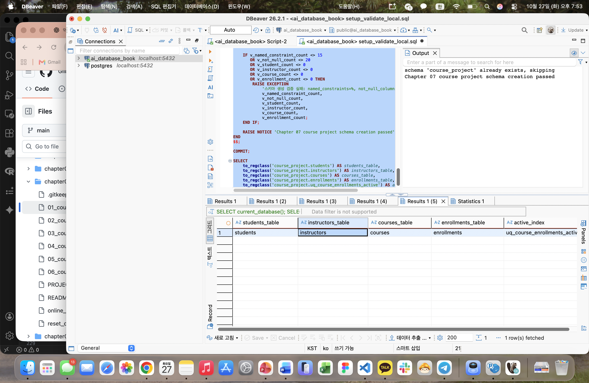
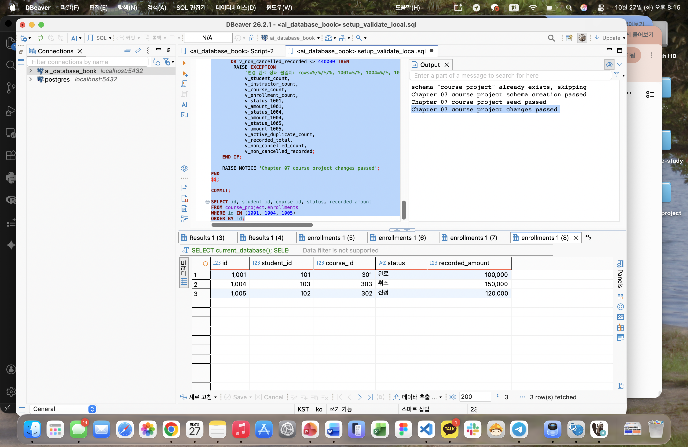
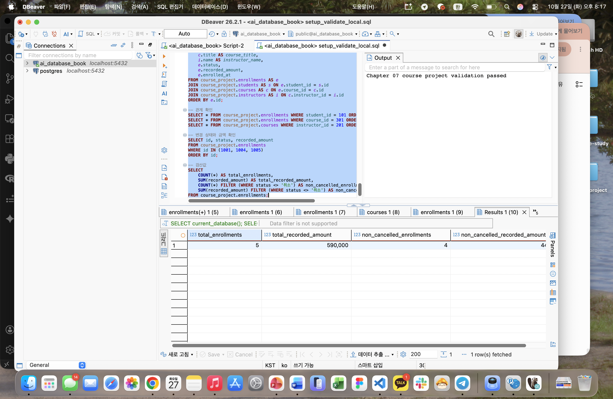
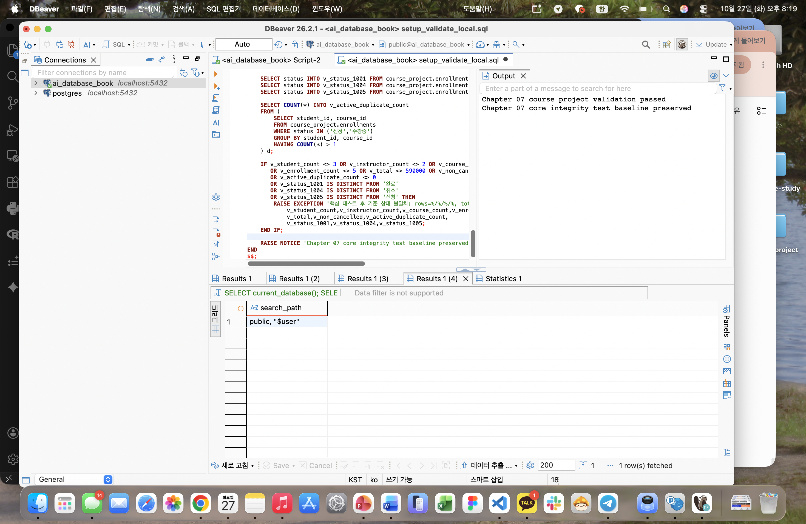

# Chapter 07 확장 실습 답안 템플릿

> **과제:** 실전 프로젝트 1 — 온라인 강의 수강신청 DB 완성하기  
> **사용 방법:** 이 파일을 내려받아 본인의 GitHub 저장소에 `chapter07_answer.md`라는 이름으로 저장한 뒤 실습하면서 바로 작성합니다.  
> **제출 방법:** LMS에는 파일을 직접 업로드하지 않고, **본인 GitHub 저장소의 `chapter07_answer.md` 파일 URL**을 제출합니다.

---

## 제출 전 주의

이 파일과 캡처 화면에는 실제 비밀번호, 전체 DB 접속 URL, API Key, 개인정보를 기록하지 않습니다.

```text
GitHub 계정 또는 별칭: gosaengchung
과제 작성일: 2026-10-27
사용한 AI 도구: GPT 6 Sol
```

---

# 1. 시작 환경 확인

다음을 실행합니다.

```sql
SELECT current_database();
SELECT current_user;
SELECT current_schema();
SHOW search_path;
SHOW transaction_read_only;
```

| 확인 항목 | 실제 결과 | 의미 |
| --- | --- | --- |
| `current_database()` | ai_database_book | 현재 접속한 데이터베이스 이름 |
| `current_user` | postgres | 현재 데이터베이스의 소유자 이름이 postgres |
| `current_schema()` | course_project | 현재 위치한 데이터베이스 내 스키마가 course_project라는 스키마 |
| `search_path` | course_project, public| 어느 스키마부터 순서대로 찾아볼지 결정|
| `transaction_read_only` | off | 이 데이터베이스의 구조를 바꿀 수 있는 권한이 커져있다. (읽기 전용 모드가 off되어 있으므로) |

- [x] 현재 DB가 `ai_database_book`이다.
- [x] 쓰기 가능한 연결인지 확인했다.
- [x] 실행할 SQL 범위를 확인했다.
- [x] Auto-commit 상태를 확인했다.

### 프로젝트 SQL을 실행하기 전에 시작 상태를 확인해야 하는 이유

```text
현재 위치한 데이터베이스 및 유저, path를 확인해야 프로젝트의 실행 위치 및 방식을 제대로 파악할 수 있음
```

---

# 2. 프로젝트 범위와 요구사항 읽기

## 2-1. 포함 범위

본문을 그대로 복사하지 말고 자신의 말로 정리합니다.

```text
1. 학생과 강사의 기본 정보를 저장한다.
2. 강의 정보와 강의를 맡은 강사를 관리한다.
3. 학생의 강의 신청을 수강신청 사건으로 기록한다.
4. 신청일과 신청 상태를 관리한다.
5. 강의의 현재 기준 가격과 신청 당시 기록 금액을 구분해 저장한다.
```

## 2-2. 제외 범위

```text
1. 카드 승인이나 결제 실패 등 실제 결제 처리는 다루지 않는다.
2. 결제 후 환불이나 환불 금액 관리도 포함하지 않는다.
3. 강의 정원이나 대기 신청 순서를 관리하지 않는다.
4. 신청 상태가 바뀐 전체 이력을 별도로 저장하지 않는다.
5. 강의 진도, 수료 여부, 강의 콘텐츠와 쿠폰·할인 이력은 다루지 않는다.
```

### 범위를 명확하게 정해야 하는 이유

```text
범위를 먼저 정하면 이번 데이터베이스가 저장하고 관리할 정보와 다루지 않을 기능을 구분할 수 있어 필요한 테이블과 제약조건을 최소화할 수 있음
```

## 2-3. 요구사항 / 프로젝트 결정 / 미확정 질문 구분

아래 항목 중 대표 항목을 정리합니다.

| ID | 종류 | 내용 요약 | DB 구조/규칙에 미치는 영향 |
|---|---|---|---|
| P07-R06 | 요구사항 | 신청 상태는 신청·수강중·완료·취소 중 하나다. | `enrollments.status`에 허용할 상태값을 제한한다. |
| P07-D03 | 프로젝트 결정 | 진행 중인 중복 신청은 허용하지 않는다. | 같은 학생이 같은 강의에 진행 중인 신청을 중복으로 등록하지 못하게 규칙을 둔다. |
| P07-Q01 | 미확정 질문 | 학생과 강사의 이메일을 서로 간에도 고유하게 제한할 것인가? | 정책이 정해지기 전에는 두 테이블을 아우르는 이메일 고유성 규칙을 확정하지 않는다. |

### 미확정 질문을 바로 제약조건으로 만들면 안 되는 이유

```text
미확정 정책을 먼저 제약조건으로 만들면, 나중에 정책이 달라졌을 때 제약조건에 맞춰 저장된 데이터도 모두 수정해야할 수 있기 때문
또한 미확정 정책을 살려두는 것이 추후 데이터베이스 검증 및 설계에 도움이 됨
```

---

# 3. 네 테이블의 한 행 의미와 관계

## 3-1. 한 행 의미

```text
course_project.students 한 행 = 학생 한명

course_project.instructors 한 행 = 교수자 한명

course_project.courses 한 행 = 개설된 강의 한개

course_project.enrollments 한 행 = 특정 학생이 특정 강의에 신청한 사건 한 건
```

## 3-2. 키와 중요 규칙

| 테이블 | PK | FK | 중요 규칙 |
|---|---|---|---|
| `students` | `id` | 없음 | 이름·이메일·가입일은 필수이며, 이메일은 학생 테이블 안에서 중복될 수 없다. 이름과 이메일은 공백만 입력할 수 없다. |
| `instructors` | `id` | 없음 | 이름·이메일·전문 분야는 필수이며, 이메일은 강사 테이블 안에서 중복될 수 없다. 이름·이메일·전문 분야는 공백만 입력할 수 없다. |
| `courses` | `id` | `instructor_id` → `instructors.id` | 담당 강사·제목·난이도·가격·개설일은 필수다. 난이도는 `basic`, `intermediate`, `advanced` 중 하나이며 가격은 0 이상이다. |
| `enrollments` | `id` | `student_id` → `students.id`<br>`course_id` → `courses.id` | 학생·강의·신청일·상태·기록 금액은 필수다. 상태는 신청·수강중·완료·취소 중 하나이고 기록 금액은 0 이상이다. 같은 학생의 같은 강의에 대해 신청 또는 수강중 상태인 행은 중복으로 만들 수 없다. |

## 3-3. 관계를 양방향 문장으로 작성

```text
instructors ↔ courses: instructors 1 ── N courses 

students ↔ enrollments: students 1 ── N enrollments ── 1 courses

courses ↔ enrollments: enrollments N ── 1 courses

```

### 학생과 강의의 N:M 관계가 `enrollments`를 통해 어떻게 바뀌는지 설명

```text
한 학생은 여러 강의에 신청할 수 있고, 한 강의에도 여러 학생이 신청할 수 있어 학생과 강의는 N:M 관계다.
enrollments가 학생과 강의의 ID를 각각 참조하면서 이 관계를 두 개의 1:N 관계로 나눈다.
즉 한 학생은 여러 신청을 가질 수 있고, 한 강의도 여러 신청을 가질 수 있다.
```

### `enrollments`가 단순 연결 테이블이 아니라 사건 테이블이라고 볼 수 있는 이유

```text
enrollments는 학생과 강의의 ID만 연결하는 것이 아니라, 신청일(enrolled_at), 신청 상태(status), 신청 당시 기록 금액(recorded_amount)도 함께 저장한다.
이 값들은 학생이 특정 강의에 신청한 사건의 시점과 상태, 금액을 나타내므로 수강신청 사건을 기록하는 테이블이라고 볼 수 있다.
```

---

# 4. `recorded_amount`의 의미 이해

```text
courses.price = 현재 강의에 설정된 기준 가격

enrollments.recorded_amount = 수강신청이 생성될 때 해당 신청 기록에 저장한 금액
```

### 두 값이 처음에는 같아도 같은 의미가 아닌 이유

```text
이번 프로젝트에는 할인 기능이 없으므로 신청을 만들 때 courses.price를 recorded_amount에 복사한다.
그래서 처음에는 두 값이 같지만, courses.price는 현재 강의의 기준 가격이고 recorded_amount는 특정 신청 당시의 기록 금액이라 의미와 기준 시점이 다르다.
```

### `recorded_amount`를 실제 결제 성공액이나 회계 매출로 해석하면 안 되는 이유

```text
이번 프로젝트는 결제 승인·실패·환불 처리를 범위에 포함하지 않는다.
따라서 recorded_amount는 신청 당시 저장한 금액일 뿐, 실제 결제가 성공했는지 또는 환불이 있었는지를 나타내지 않는다. 회계상 매출을 뜻하는 값도 아니다.
```

---

# 5. STEP 01 — 스키마와 테이블 생성

실행 파일:

```text
code/chapter07/01_course_project_schema.sql
```

## 5-1. 실행 전 예상

```text
course_project 스키마 존재 여부: 실행 전에는 없음
예상 테이블 수: 4개
예상 데이터 행 수: 0행
예상되는 명명 제약조건 수: 15개
예상되는 NOT NULL 열 수: 20개
부분 고유 인덱스 존재 여부: 있음
```

## 5-2. 실행 결과

```text
실제 테이블 수: 확인 필요
실제 명명 제약조건 수: 확인 필요
실제 NOT NULL 열 수: 확인 필요
부분 고유 인덱스: 확인 필요
네 테이블의 실제 행 수: 확인 필요
통과 메시지: schema "course_project" already exists, skipping
Chapter 07 course project schema creation passed
```

### 예상과 실제 비교

```text
스크립트는 course_project 스키마가 없는 상태를 예상했지만, 실행 당시 해당 스키마가 이미 존재해 첫 번째 검사에서 중단됐다.
따라서 테이블 생성과 검증까지 완료되지 않았고, 통과 메시지도 출력되지 않았다.
스키마 안에 기존 객체가 있는지 확인한 뒤 빈 스키마라면 삭제하고 스크립트를 다시 실행해야 한다. (실행 후 정상처리 됨)
```

### 증거 화면

권장 경로:

```text
assignments/chapter07/images/step05_schema.png
```

`여기에 스키마/테이블 생성 검증 화면을 삽입하세요.`

---

# 6. STEP 02 — Seed 데이터 입력

실행 파일:

```text
code/chapter07/02_course_project_seed.sql
```

## 6-1. 실행 전 예상

```text
students: 3
instructors: 2
courses: 3
enrollments: 4
recorded_amount 합계: 470,000
학생 101 신청 건수: 2건
강의 301 신청 건수: 2건
강사 201 담당 강의 수: 2개
활성 중복 신청: 0건
```

## 6-2. 실제 결과

```text
students: 3
instructors: 2
courses: 3
enrollments: 4
recorded_amount 합계: 470,000
학생 101 신청 건수: 2건
강의 301 신청 건수: 2건
강사 201 담당 강의 수: 2개
활성 중복 신청: 0건
1001 상태: 수강중
1004 상태: 신청
1005 존재 여부: 없음
통과 메시지: Chapter 07 course project seed passed
```

### Seed 데이터를 단순 예제가 아니라 검증 데이터라고 볼 수 있는 이유

```text
이 데이터는 테이블에 행을 채우는 데 그치지 않고, 수강신청과 강의·학생의 관계, 신청 상태, 기록 금액 합계, 활성 중복 신청 제한이 예상대로 작동하는지 확인하도록 구성되어 있다.
스크립트는 각 조건을 검사하고, 기대한 값과 다르면 오류를 발생시킨다. 따라서 프로젝트의 구조와 규칙을 확인하는 검증 데이터라고 볼 수 있다.
```

---

# 7. STEP 03 — 변경 시나리오 실행

실행 파일:

```text
code/chapter07/03_course_project_changes.sql
```

## 7-1. 실행 전에 상태 변화를 예상

| 신청 ID | 변경 전 예상 상태 | 변경 후 예상 상태 | 예상 `recorded_amount` |
|---:|---|---|---:|
| 1001 | 수강중 | 완료 | 100,000 |
| 1004 | 신청 | 취소 | 150,000 |
| 1005 | 없음 | 신청 | 120,000 |

```text
변경 후 예상 enrollments 행 수: 5건
변경 후 예상 전체 recorded_amount 합계: 590,000
변경 후 예상 취소 제외 건수: 4건
변경 후 예상 취소 제외 recorded_amount 합계: 440,000
```

## 7-2. 실제 결과

```text
1001 상태 / recorded_amount: 완료 / 100,000
1004 상태 / recorded_amount: 취소 / 150,000
1005 상태 / recorded_amount: 신청 / 120,000
최종 enrollments 행 수: 5건
전체 recorded_amount 합계: 590,000
취소 제외 건수: 4건
취소 제외 recorded_amount 합계: 440,000
활성 중복 신청: 0건
통과 메시지: Chapter 07 course project changes passed
```

### 조건부 UPDATE에서 예상 이전 상태를 확인해야 하는 이유

```text
UPDATE 문에 기존 상태를 조건으로 넣으면, 예상한 상태의 행만 변경할 수 있다.
예를 들어 1001번 신청이 '수강중'일 때만 '완료'로 바꾸도록 하면, 이미 취소되었거나 완료된 행을 실수로 다시 변경하는 일을 막을 수 있다.
RETURNING 결과로 실제 변경된 행과 변경 후 상태도 확인할 수 있다.
```

### 증거 화면

권장 경로:

```text
assignments/chapter07/images/step07_changes.png
```


---

# 8. STEP 04 — 최종 완료 게이트 실행

실행 파일:

```text
code/chapter07/04_course_project_validation.sql
```

## 8-1. 최종 검증 결과

```text
최종 행 수 students/instructors/courses/enrollments: 3 / 2 / 3 / 5
서비스 JOIN 결과 행 수: 5
학생 101 신청 수: 2건
강의 301 신청 수: 2건
강사 201 강의 수: 2개
고아 관계 수: 0건
활성 중복 신청 수: 0건
전체 recorded_amount: 590,000
취소 제외 recorded_amount: 440,000
통과 메시지: Chapter 07 course project validation passed
```

### SQL 파일 4개가 모두 실행되었다는 사실과 프로젝트 검증 PASS가 다른 이유

```text
SQL 파일이 오류 없이 실행됐다는 것은 각 명령이 실행됐다는 뜻일 뿐, 테이블 구조와 데이터가 프로젝트의 요구사항을 모두 만족한다는 뜻은 아니다.
최종 검증은 테이블과 제약조건의 수, 행 수, JOIN 결과, 관계의 누락 여부, 신청 상태와 금액 등을 다시 확인한다.
따라서 이 조건을 모두 만족하고 검증 스크립트가 통과 메시지를 출력해야 프로젝트 검증 PASS라고 할 수 있다.
```

### 증거 화면

권장 경로:

```text
assignments/chapter07/images/step08_validation.png
```



---

# 9. 무결성 테스트

실행 파일:

```text
code/chapter07/05_course_project_integrity_tests.sql
```

> 오류 테스트는 파일 전체를 무작정 실행하지 않고 **한 테스트 구간씩** 실행합니다.

## 9-1. 허용되어야 하는 경계값 1개

```text
테스트 내용: 가격이 0이고 설명이 NULL인 무료 강의를 만든 뒤, 기록 금액이 0인 신청을 생성한다.
기대 결과: 두 INSERT 모두 성공하고, 테스트 행을 삭제할 수 있다.
실제 결과: 성공 후 테스트 강의와 신청 행 삭제
왜 허용되어야 하는가: 가격과 기록 금액은 0 이상이면 허용되며, description은 NULL을 허용하는 열이기 때문이다.
```

## 9-2. 실패해야 하는 테스트 1 — 잘못된 참조 또는 값

```text
테스트 내용: 신청 상태에 허용되지 않은 값 '대기'를 입력한다.
기대 결과: INSERT가 실패한다.
실제 오류 핵심: violates check constraint "chk_course_enrollments_status"
동작한 제약조건/규칙: chk_course_enrollments_status CHECK 제약조건
왜 실패해야 하는가: 신청 상태는 '신청', '수강중', '완료', '취소' 중 하나만 허용하기 때문이다.
```

## 9-3. 실패해야 하는 테스트 2 — 활성 중복 신청

```text
테스트 내용: 학생 101이 이미 활성 신청한 강의 302에 신청 상태 행을 추가한다.
기대 결과: INSERT가 실패한다.
실제 오류 핵심: duplicate key value violates unique constraint "uq_course_enrollments_active"
동작한 인덱스/규칙: uq_course_enrollments_active 부분 고유 인덱스
왜 실패해야 하는가: 같은 학생과 강의 조합에 '신청' 또는 '수강중' 상태의 신청이 이미 있으면 중복 활성 신청을 허용하지 않기 때문이다.
```

## 9-4. 실패 후 기준 상태 재검증

```text
04 validation 재실행 결과:
기준 데이터가 유지되었는가:
```

### 실패 테스트가 프로젝트 품질 검증에 필요한 이유

```text
04 validation 재실행 결과: 통과 — Chapter 07 core integrity test baseline preserved
기준 데이터가 유지되었는가: 예. students/instructors/courses/enrollments 행 수가 3/2/3/5로 유지되고, recorded_amount 합계도 590,000으로 유지되었다.
```

### 증거 화면

권장 경로:

```text
assignments/chapter07/images/step09_integrity.png
```

`여기에 대표 실패 테스트와 기준 상태 유지 결과를 삽입하세요.`

---

# 10. 재현성 실험

> 이 단계는 본인의 실습 환경이며 보존할 데이터가 없을 때만 수행합니다.

실행 순서:

```text
reset_course_project.sql
→ 01_course_project_schema.sql
→ 02_course_project_seed.sql
→ 03_course_project_changes.sql
→ 04_course_project_validation.sql
```

```text
처음 실행의 최종 결과: 검증 통과, 행 수 3/2/3/5, 전체 recorded_amount 590,000, 취소 제외 금액 440,000
재실행의 최종 결과: 검증 통과, 행 수 3/2/3/5, 전체 recorded_amount 590,000, 취소 제외 금액 440,000
두 결과가 일치했는가: 예
중간에 수동 수정이 필요했는가: 아니오
```

### 다른 사람이 같은 순서로 실행해 같은 결과를 얻는 것이 중요한 이유

```text
정해진 순서대로 실행해 같은 결과를 얻을 수 있으면, 특정 환경의 임시 데이터나 수동 작업에 의존하지 않고도 데이터베이스 구조와 검증 결과를 재현할 수 있다.
이는 다른 사람도 프로젝트를 확인하고, 문제가 생겼을 때 같은 조건에서 원인을 찾을 수 있게 해준다.
```

---

# 11. Chapter 01~06 개인 프로젝트를 중간 프로젝트 초안으로 확장

온라인 강의 예제를 이름만 바꾸지 않고 본인의 아이디어를 사용합니다.

## 11-1. 프로젝트 기본 정보

```text
프로젝트 이름: 픽로그(Picklog): 주식 분석 기록과 투자 성향별 복기 서비스

해결하려는 문제:
투자 판단을 내릴 때의 근거와 시간이 지난 뒤 달라진 생각을 따로 기록하지 않으면, 왜 특정 종목을 선택했는지와 판단이 어떻게 바뀌었는지 되돌아보기 어렵다.
픽로그는 종목별 투자 판단과 복기 내용을 저장해 사용자가 자신의 투자 과정을 다시 살펴볼 수 있게 한다.

주요 사용자:
투자 근거를 기록하고, 투자 성향이나 전략에 따라 자신의 판단을 복기하려는 개인 투자자와 주식 스터디 참여자
```

## 11-2. 포함 범위 / 제외 범위

```text
[포함]
1. 사용자의 투자 판단 기록을 저장한다.
2. 종목별로 판단 날짜, 투자 전략, 판단 근거를 기록한다.
3. 기존 판단 기록에 복기 날짜와 결과·생각을 추가한다.
4. 투자 전략이나 종목을 기준으로 기록을 찾아볼 수 있도록 데이터를 구성한다.

[제외]
1. 실제 증권 계좌 연결과 매수·매도 주문은 처리하지 않는다.
2. 실시간 주가 수집이나 자동 수익률 계산은 포함하지 않는다.
3. AI의 종목 추천이나 투자 판단 제공은 포함하지 않는다.
```

## 11-3. 요구사항

최소 8개를 작성합니다.

| ID | 요구사항 | 관련 테이블/관계 | 검증 방법 후보 |
|---|---|---|---|
| P07-MR01 | 사용자는 서비스에 회원으로 등록되어야 한다. | `members` | 회원 행 생성 및 필수값 확인 |
| P07-MR02 | 종목은 종목 코드와 종목명으로 관리한다. | `stocks` | 종목 코드의 PK 또는 UNIQUE 제약 확인 |
| P07-MR03 | 사용자는 투자 판단 기록을 작성할 때 대상 종목을 지정해야 한다. | `members` 1:N `investment_records`; `stocks` 1:N `investment_records` | 유효한 회원·종목 참조로 기록 생성, 없는 ID 참조 시 실패 확인 |
| P07-MR04 | 투자 판단 기록에는 판단 날짜, 당시 전략, 판단 근거를 저장한다. | `investment_records` | 필수값 및 허용 전략값 확인 |
| P07-MR05 | 한 투자 판단 기록에는 복기 내용을 남길 수 있다. | `investment_records` 1:N `reviews` | 하나의 기록에 복기 행 생성 확인 |
| P07-MR06 | 복기에는 복기 날짜와 결과 또는 판단 변화 내용을 저장한다. | `reviews` | 필수값과 날짜 저장 확인 |
| P07-MR07 | 사용자는 투자 전략을 기준으로 자신의 판단 기록을 조회할 수 있어야 한다. | `investment_records` | 전략별 조회 결과가 해당 전략의 기록만 포함하는지 확인 |
| P07-MR08 | 같은 사용자가 같은 종목에 대해 시점이 다른 투자 판단을 여러 번 기록할 수 있다. | `members` 1:N `investment_records`; `stocks` 1:N `investment_records` | 동일 회원·종목 조합으로 날짜가 다른 기록 여러 건 생성 확인 |

## 11-4. 프로젝트 결정

최소 3개를 작성합니다.

| ID | 이번 프로젝트에서 내린 결정 | 이유 | 구현 후보 |
|---|---|---|---|
| P07-MD01 | 투자 전략은 각 판단 기록에 저장한다. | 사용자의 투자 방식이 바뀌더라도 과거 판단을 당시 기준으로 복기할 수 있어야 한다. | `investment_records.strategy` 열 |
| P07-MD02 | 하나의 판단 기록에 복기 기록을 여러 번 남길 수 있게 한다. | 판단 직후와 이후 시점의 생각을 비교할 수 있도록 하기 위해서다. | `reviews.investment_record_id` 외래 키 |
| P07-MD03 | 같은 사용자가 같은 종목에 대해 여러 판단 기록을 작성할 수 있게 한다. | 한 종목에 대한 투자 판단이 시간에 따라 달라질 수 있기 때문이다. | 회원 ID와 종목 ID 조합에 UNIQUE 제약을 두지 않음 |

## 11-5. 미확정 질문

최소 3개를 작성합니다.

```text
P07-MQ01. 투자 판단 기록은 실제 매수·매도 내역까지 포함할 것인가, 분석과 판단만 기록할 것인가?
P07-MQ02. 판단 당시 주가나 목표 가격을 사용자가 직접 입력할 것인가, 외부 시세 데이터를 연동할 것인가?
P07-MQ03. 투자 전략의 선택지를 고정된 목록으로 제한할 것인가, 사용자가 직접 이름을 정할 수 있게 할 것인가?
```

---

# 12. 개인 프로젝트 ERD와 한 행 의미

## 12-1. 테이블 후보

최소 4개를 권장합니다.

| 테이블 | 한 행의 의미 | PK 후보 | FK 후보 | 주요 규칙 |
|---|---|---|---|---|
| `members` | 서비스를 이용하는 회원 한 명 | `member_id` | 없음 | 회원 이메일은 필수이며 중복을 허용하지 않음 |
| `stocks` | 서비스에서 기록 대상으로 관리하는 종목 한 개 | `stock_id` | 없음 | 종목 코드는 필수이며 중복을 허용하지 않음 |
| `investment_records` | 회원 한 명이 특정 종목에 대해 특정 시점에 내린 투자 판단 한 건 | `record_id` | `member_id` → `members.member_id`<br>`stock_id` → `stocks.stock_id` | 판단 날짜·전략·근거는 필수. 같은 회원과 종목의 판단 기록을 여러 건 허용 |
| `reviews` | 기존 투자 판단 기록을 특정 시점에 되돌아본 내용 한 건 | `review_id` | `record_id` → `investment_records.record_id` | 복기 날짜와 복기 내용은 필수. 각 복기는 하나의 판단 기록에 연결 |

## 12-2. 관계 문장

```text
1. 한 회원은 여러 투자 판단 기록을 작성할 수 있고, 각 투자 판단 기록은 한 회원을 참조한다.
2. 한 종목에는 여러 회원의 투자 판단 기록이 연결될 수 있고, 각 투자 판단 기록은 한 종목을 참조한다.
3. 하나의 투자 판단 기록에는 복기 기록이 없거나 여러 건 연결될 수 있고, 각 복기 기록은 하나의 투자 판단 기록에 연결된다.
```

## 12-3. ERD

권장 이미지 경로:

```text
assignments/chapter07/images/personal_project_erd.png
```


### Chapter 05~06 ERD에서 이번에 바꾼 점

```text
회원과 종목의 관계는 투자 판단 기록을 통해 연결하고, 투자 판단 당시의 전략과 근거도 기록에 포함했다.
복기 내용은 투자 판단 기록과 분리해 여러 시점의 복기를 연결할 수 있도록 설계했다.
```

---

# 13. 개인 프로젝트 완료 기준 만들기

“잘 동작한다”처럼 모호하게 쓰지 말고 검증 가능한 기준을 최소 6개 작성합니다.

| 번호 | 완료 기준 | 자동 SQL 검증 가능? | 검증 방법 |
|---:|---|---|---|
| 1 | Seed 실행 후 `members/stocks/investment_records/reviews` 행 수가 각각 3/4/6/5다. | 가능 | 각 테이블의 `COUNT(*)` 확인 |
| 2 | 투자 판단 기록이 존재하지 않는 회원이나 종목을 참조하는 경우가 0건이다. | 가능 | 외래 키 또는 LEFT JOIN으로 고아 관계 조회 |
| 3 | 복기 기록이 존재하지 않는 투자 판단 기록을 참조하는 경우가 0건이다. | 가능 | 외래 키 또는 LEFT JOIN으로 고아 관계 조회 |
| 4 | 회원·종목·투자 판단·복기의 필수 항목에 NULL이나 공백 값이 없다. | 가능 | `NOT NULL`, `CHECK`와 검증 쿼리 확인 |
| 5 | 같은 회원이 같은 종목에 대해 날짜가 다른 판단 기록을 2건 이상 저장할 수 있다. | 가능 | 같은 회원·종목 조합의 복수 기록 입력 후 행 수 확인 |
| 6 | 복기 기록을 투자 판단 기록별로 조회할 수 있고, 선택한 기록과 연결되지 않은 복기는 결과에 포함되지 않는다. | 가능 | FK JOIN 조회 결과 확인 |

예시 형식:

```text
Seed 실행 후 A/B/C/D 테이블의 행 수가 각각 5/3/8/12다.
존재하지 않는 부모를 참조하는 행은 0건이다.
허용되지 않은 상태 입력은 DB가 거부한다.
검증 SQL이 예상 결과를 반환한다.
```

---

# 14. AI를 프로젝트 리뷰어로 사용

AI에게 프로젝트를 대신 완성시키지 않고 누락과 위험을 찾게 합니다.

## 14-1. AI에게 전달한 핵심 자료

```text
요구사항:
회원과 종목을 관리하고, 회원이 종목별 투자 판단과 당시 전략·근거를 기록한다.
각 투자 판단에는 복기 기록을 여러 건 연결할 수 있다.
투자 판단은 전략이나 종목 기준으로 조회할 수 있어야 한다.

테이블/ERD 설명:
members는 회원 한 명, stocks는 종목 한 개, investment_records는 특정 회원의 특정 종목에 대한 판단 한 건, reviews는 그 판단을 되돌아본 기록 한 건이다.
investment_records는 members와 stocks를 각각 외래 키로 참조하고, reviews는 investment_records를 참조한다.

프로젝트 결정:
전략은 투자 판단 기록마다 저장한다.
한 판단 기록에 복기 기록을 여러 건 남길 수 있다.
같은 회원이 같은 종목에 대해 시점이 다른 판단 기록을 여러 건 작성할 수 있다.

미확정 질문:
실제 매매 내역까지 저장할지, 시세를 직접 입력하거나 외부 연동할지, 투자 전략 선택지를 고정할지 정하지 않았다.

완료 기준:
Seed 데이터 행 수, FK 관계, 필수값, 같은 회원·종목의 복수 판단 기록, 판단 기록별 복기 조회를 검증한다.
```

## 14-2. 내가 사용한 프롬프트

```text
아래 픽로그 요구사항과 테이블 초안을 검토해줘.
프로젝트를 대신 확장하거나 새 기능을 임의로 추가하지 말고, 요구사항 누락·테이블 관계의 모호함·검증하기 어려운 규칙을 찾아줘.

특히 다음을 확인해줘.
1. 회원, 종목, 투자 판단 기록, 복기 기록의 한 행 의미와 관계가 명확한가?
2. 같은 회원이 같은 종목에 대해 시점별 판단을 여러 번 남길 수 있는가?
3. 미확정 정책을 확정된 제약조건처럼 취급하고 있지는 않은가?
4. 각 요구사항을 SQL로 검증할 방법이 있는가?

제안마다 문제점, 이유, 수정 후보를 구분하고, 아직 정책이 정해지지 않은 부분은 미확정 질문으로 표시해줘.
```

## 14-3. AI 제안 검토

| AI 제안 | 수용 / 수정 / 보류 / 거절 | 실제 근거 | 반영 내용 |
|---|---|---|---|
| 투자 판단 기록과 실제 매매 내역을 별도 개념으로 구분한다. | 수용 | 이번 프로젝트 범위는 판단과 복기 기록이며, 실제 주문·거래 처리는 제외했다. | `investment_records`를 판단 기록으로 정의하고 실제 거래 기능은 범위에서 제외했다. |
| 회원·종목 조합에 UNIQUE 제약을 둬 중복 기록을 막는다. | 거절 | 같은 회원이 같은 종목에 대해 시점별로 여러 판단을 남길 수 있어야 한다. | 해당 조합에 UNIQUE 제약을 두지 않는 결정(MD03)을 유지한다. |
| 복기 기록이 판단 기록을 참조하도록 외래 키를 둔다. | 수용 | 모든 복기는 특정 투자 판단을 되돌아보는 기록이어야 한다. | `reviews.investment_record_id`를 외래 키 후보로 둔다. |
| 투자 전략을 정해진 값만 허용하도록 CHECK 제약을 둔다. | 보류 | 전략 선택지를 고정할지 아직 결정되지 않았다. | 선택지 정책이 확정될 때까지 허용값 제약은 추가하지 않는다. |

### AI가 미확정 정책을 임의로 확정하려 한 부분이 있었나요?

```text
전략 선택지를 고정된 값으로 제한하자는 제안은 미확정 정책에 해당한다.
전략 목록을 아직 정하지 않았으므로 이를 곧바로 CHECK 제약조건으로 만들지 않고, 미확정 질문으로 남겼다.
```

### AI가 제안한 규칙 중 아직 배우지 않은 기능이라 보류한 것이 있나요?

```text
현재 초안에서는 기본 키, 외래 키, NOT NULL, UNIQUE, CHECK와 기본 JOIN 조회로 검증할 수 있는 범위에 집중했다.
트리거나 복잡한 자동화처럼 아직 다루지 않은 기능은 제안이 있더라도 이번 설계에는 반영하지 않았다.
```

### AI 활용 후 실제로 좋아진 부분

```text
투자 판단 기록과 실제 매매 내역을 구분하고, 복기 기록이 어느 판단에 속하는지 관계를 명확히 했다.
또한 같은 종목에 대한 반복 판단을 허용해야 한다는 점과, 전략 선택지는 정책 확인 후 제약조건으로 정해야 한다는 점을 완료 기준과 미확정 질문에 반영했다.
```

---

# 15. 최종 성찰

아래 문장은 반드시 본인의 말로 작성합니다.

```text
1. 데이터베이스 프로젝트가 완료되었다고 판단하려면
   SQL 파일의 존재보다 요구사항에 맞는 구조와 데이터가 검증을 통과하는 것이 중요하다.

2. Seed 데이터의 목적은 단순히 화면을 채우는 것이 아니라
   테이블 간 관계와 주요 규칙이 예상대로 작동하는지 확인하는 것이다.

3. 실패 테스트가 필요한 이유는
   잘못된 값이나 참조가 데이터베이스 제약조건에 의해 실제로 거부되는지 확인하기 위해서다.

4. 요구사항과 프로젝트 결정을 구분해야 하는 이유는
   반드시 지켜야 할 조건과 이번 버전에서 선택한 방식을 혼동하지 않고, 설계의 근거를 분명히 하기 위해서다.

5. 내가 만든 개인 프로젝트에서 가장 먼저 추가 확인해야 할 정책은
   투자 판단 기록에 실제 매매 내역까지 포함할지, 분석과 판단만 기록할지 여부다.
```

---

# 16. 제출 체크리스트

- [x] `chapter07_answer.md`를 본인 저장소에 만들었다.
- [x] 시작 환경과 현재 DB를 확인했다.
- [x] 프로젝트 포함/제외 범위를 설명했다.
- [x] 요구사항/결정/미확정 질문을 구분했다.
- [x] 네 테이블의 한 행 의미와 관계를 설명했다.
- [x] `01_course_project_schema.sql`을 실행하고 결과를 확인했다.
- [x] `02_course_project_seed.sql`의 기준 상태를 확인했다.
- [x] `03_course_project_changes.sql` 전후 상태를 비교했다.
- [x] `04_course_project_validation.sql` PASS를 확인했다.
- [x] 허용 경계값 1개 이상을 확인했다.
- [x] 실패 테스트 2개 이상을 한 구간씩 실행했다.
- [x] 실패 후 validation을 다시 실행했다.
- [x] 개인 프로젝트 요구사항 8개 이상을 작성했다.
- [x] 프로젝트 결정 3개 이상과 미확정 질문 3개 이상을 작성했다.
- [x] 개인 프로젝트 ERD를 작성했다.
- [x] 검증 가능한 완료 기준 6개 이상을 작성했다.
- [x] AI 제안을 수용/수정/보류/거절로 구분했다.
- [x] 핵심 캡처는 3~4장 정도로 정리했다.
- [x] 캡처에 비밀번호나 개인정보가 없다.
- [x] GitHub 웹에서 Markdown과 이미지가 정상적으로 보인다.
- [x] 최종 파일을 commit/push했다.

---

# 17. LMS 제출 URL

아래 형식의 **본인 GitHub 파일 URL**을 LMS에 제출합니다.

```text
https://github.com/<본인-GitHub-ID>/<본인-저장소>/blob/main/assignments/chapter07/chapter07_answer.md
```

내 제출 URL:

```text
https://github.com/gosaengchung/ai-database-study/blob/main/assignments/chapter07/chapter07_answer.md
```

> 저장소 메인 URL, 교수자 템플릿 URL, Raw URL이 아니라 **작성 완료된 본인 `chapter07_answer.md` 파일 화면 URL**을 제출합니다.
