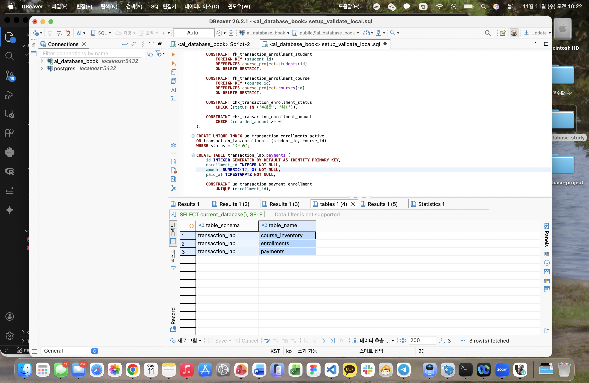
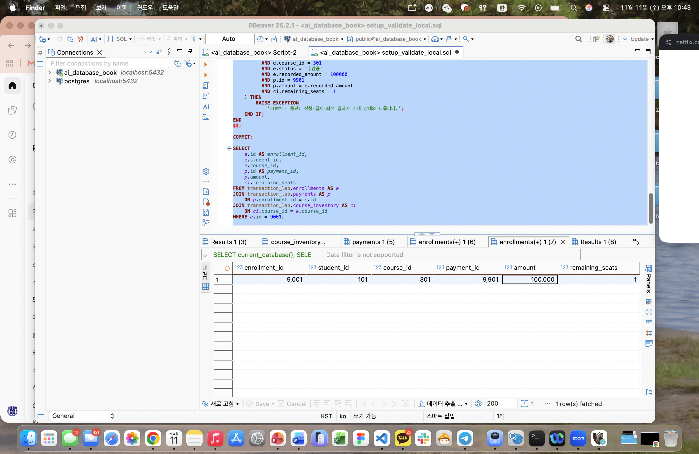
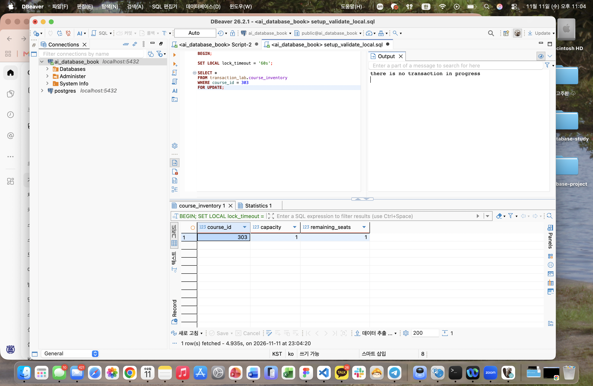

# Chapter 09 확장 실습 답안 템플릿

> **과제:** 트랜잭션으로 데이터 정합성 지키기  
> **사용 방법:** 이 파일을 내려받아 본인의 GitHub 저장소에 `chapter09_answer.md`라는 이름으로 저장한 뒤 실습하면서 바로 작성합니다.  
> **제출 방법:** LMS에는 파일을 직접 업로드하지 않고, **본인 GitHub 저장소의 `chapter09_answer.md` 파일 URL**을 제출합니다.

---

## 제출 전 주의

이 파일과 캡처 화면에는 실제 비밀번호, 전체 DB 접속 URL, API Key, 개인정보를 기록하지 않습니다.

```text
GitHub 계정 또는 별칭: gosaengchung
과제 작성일: 2026-11-10
사용한 AI 도구: GPT 6 Sol
```

---

# 1. 시작 환경과 Chapter 07·08 기준 상태 확인

다음을 실행하거나 Chapter 09의 `01_transaction_lab_schema.sql` 사전 검사를 확인합니다.

```sql
SELECT current_database();
SELECT current_user;
SELECT current_schema();
SHOW search_path;
SHOW transaction_read_only;
```

| 확인 항목 | 실제 결과 | 의미 |
| --- | --- | --- |
| `current_database()` | ai_database_book | 현재 접속한 데이터베이스 이름 |
| `current_user` | postgres | 현재 데이터베이스의 소유자 이름이 postgres |
| `current_schema()` | public | 현재 위치한 데이터베이스 내 스키마를 말해줌 |
| `search_path` | public, "$user"| 어느 스키마부터 순서대로 찾아볼지 결정|
| `transaction_read_only` | off | 이 데이터베이스의 구조를 바꿀 수 있는 권한이 커져있다. (읽기 전용 모드가 off되어 있으므로) |

Chapter 07·08 기준값:

```text
students = 3
instructors = 2
courses = 3
enrollments = 5
전체 recorded_amount = 590000
활성 = 3 / 340000
취소 제외 = 4 / 440000
```

### 기준 상태가 다르면 Chapter 09를 계속 진행하면 안 되는 이유

```text
transaction의 결과는 실행 당시의 데이터베이스 상태를 기준으로 결정된다. 따라서 각자 기준 상태가 다르면 같은 SQL을 실행해도 결과가 달라질 수 있고, 이후 단계의 결과도 서로 비교하기 어려워진다.
```

---

# 2. `transaction_lab` 스키마 생성

실행 파일:

```text
code/chapter09/01_transaction_lab_schema.sql
```

## 2-1. 생성 전 예상

```text
생성될 스키마: transaction_lab
생성될 테이블 3개: course_inventory / enrollments / payments

course_inventory 한 행의 의미: course_id를 매개하는 키로 하여 강의 정보를 설명하며, 정원과 현재 신청 가능 인수를 나타냄
enrollments 한 행의 의미: 학생 한 명의 강의 하나에 대한 신청을 설명하며, course_id 및 student_id를 매개한다 
payments 한 행의 의미: enrollments 하나 당 결제 정보를 설명함
```

## 2-2. 생성 결과

```text
통과 메시지: Chapter 09 transaction lab schema validation passed
```

기대 메시지:

```text
Chapter 09 transaction lab schema validation passed
```

### Chapter 07·08의 `course_project`와 별도 `transaction_lab`을 사용하는 이유

```text
transaction 실습은 INSERT, UPDATE, DELETE와 롤백을 수행하므로 기존 과제의 데이터에 영향을 줄 수 있다. Chapter 07·08의 course_project와 분리된 transaction_lab을 사용하면 기존 작업물을 보존하면서 실습 데이터를 독립적으로 초기화하고, 같은 기준 상태에서 transaction 결과를 확인할 수 있다.
```

### 증거 화면

권장 경로:

```text
assignments/chapter09/images/step02_schema.png
```

`여기에 transaction_lab 구조가 보이는 핵심 화면을 삽입하세요.`

---

# 3. 초기 좌석과 기준 데이터 입력

실행 파일:

```text
code/chapter09/02_transaction_lab_seed.sql
```

## 3-1. 실행 전 예상

```text
course 301 remaining_seats 예상: 2
course 302 remaining_seats 예상: 1
course 303 remaining_seats 예상: 1
lab enrollments 예상 행 수: 0
payments 예상 행 수: 0
```

## 3-2. 실제 결과

```text
course 301 remaining_seats: 2
course 302 remaining_seats: 1
course 303 remaining_seats: 1
lab enrollments 행 수: 0
payments 행 수: 0
통과 메시지: Chapter 09 transaction lab seed validation passed
```

기대 초기 상태:

```text
course 301 / 302 / 303 remaining_seats = 3 / 0 / 0
lab enrollments = 0
payments = 0
```

### 예상과 실제가 다른 경우 원인

```text
다르지 않음
```

---

# 4. 첫 번째 정상 COMMIT 추적

실행 파일:

```text
code/chapter09/03_commit_transaction.sql
```

이 실습은 학생 101이 강의 301을 신청하는 하나의 업무 단위를 추적합니다.

## 4-1. 업무 단위 정의

```text
이 트랜잭션에서 함께 성공해야 하는 변경 1: 강의 301의 남은 좌석을 2석에서 1석으로 변경
변경 2: 학생 101의 강의 301 신청 정보(enrollment 9001) 생성
변경 3: 신청 9001에 대한 결제 정보(payment 9901) 생성

하나라도 실패하면 전체를 취소해야 하는 이유: 좌석만 줄거나 신청만 생성되는 등 일부 변경만 반영되면 실제 수강 가능 인원, 신청 내역, 결제 내역이 서로 맞지 않기 때문
```

## 4-2. 상태 변화 기록

| 시점 | course 301 남은 좌석 | lab enrollment 9001 | payment 9901 | 설명 |
| --- | ---: | --- | --- | --- |
| BEGIN 전 | 2 | 없음 | 없음 | 시작 기준 상태 |
| 트랜잭션 내부 | 1 | 생성됨 | 생성됨 | 변경 사항이 트랜잭션 안에 반영된 상태 |
| COMMIT 후 | 1 | 생성됨 | 생성됨 | 변경 사항이 확정된 상태 |

## 4-3. COMMIT 조건

```text
좌석 UPDATE 기대 영향 행 수: 1행
실제 영향 행 수: 1행
신청 생성 기대 행 수: 1행
결제 생성 기대 행 수: 1행
recorded_amount와 payment.amount 일치 여부: 일치 (100000)
최종 COMMIT 판단: 신청·결제·좌석 변경이 모두 기대 상태와 일치하므로 COMMIT
```

기대 메시지:

```text
Chapter 09 first commit validation passed
```

### SQL 오류가 없었다는 사실만으로 COMMIT하면 안 되는 이유

```text
SQL 문법과 제약 조건에 오류가 없어도 업무상 잘못된 결과가 만들어질 수 있다. 예를 들어 좌석이 줄지 않았거나 신청·결제가 누락됐거나 결제 금액이 신청 금액과 다를 수 있다. 따라서 각 변경의 영향 행 수와 트랜잭션 종료 전 최종 상태를 확인해 모든 업무 조건이 맞을 때만 COMMIT해야 한다.
```

### 증거 화면

권장 경로:

```text
assignments/chapter09/images/step04_commit.png
```


---

# 5. ROLLBACK으로 전체 원상복구 확인

실행 파일:

```text
code/chapter09/04_rollback_transaction.sql
```

## 5-1. ROLLBACK 전 예상

```text
트랜잭션 안에서 임시로 바뀔 값: 강의 302의 남은 좌석은 1석에서 0석으로 바뀌고, 신청 9002와 결제 9902가 생성됨
ROLLBACK 후 다시 돌아와야 할 값: 강의 302의 남은 좌석은 1석으로 복구되고, 신청 9002와 결제 9902는 삭제됨
이미 이전 파일에서 COMMIT된 9001/9901은 유지되어야 하는가: 유지되어야 함. ROLLBACK은 현재 트랜잭션에서 수행한 변경만 취소함
```

## 5-2. 실제 결과

```text
ROLLBACK 후 course 301 상태: 남은 좌석 1석
ROLLBACK 후 lab enrollments 행 수: 전체 행 수는 기존 COMMIT 신청 9001만 남아 1행
ROLLBACK 후 payments 행 수: 전체 행 수는 기존 COMMIT 결제 9901만 남아 1행
9001 존재 여부: 존재함
9901 존재 여부: 존재함
통과 메시지: Chapter 09 rollback validation passed
```

기대 메시지:

```text
Chapter 09 rollback validation passed
```

## 5-3. ROLLBACK과 IDENTITY

```text
ROLLBACK이 테이블 행 변경을 되돌리는 방식: 현재 트랜잭션에서 실행한 DML문을 취소해 시작 전 상태로 복구함

IDENTITY 자동 번호가 반드시 이전 값으로 되돌아가지는 않는 이유: PostgreSQL의 시퀀스 값 증가는 일반적인 트랜잭션 변경과 별도로 처리되어, ROLLBACK해도 사용된 번호가 복구되지 않을 수 있음

번호가 건너뛰었다고 데이터 손상이라고 단정할 수 없는 이유: 자동 번호는 현재 존재하는 행의 개수를 연속해서 세는 값이 아닌 식별자를 발급하는 값이므로, 롤백을 통해 중간 번호가 비어 있어도 행과 데이터의 정합성이 유지될 수 있음
```

---

# 6. 두 번째 COMMIT과 좌석 부족 0행 관찰

실행 파일:

```text
code/chapter09/05_commit_and_sold_out.sql
```

## 6-1. 두 번째 정상 COMMIT

```text
생성된 enrollment id: 9002
학생 id: 103
course id: 302
recorded_amount: 120000
payment id: 9902
payment amount: 120000
```

## 6-2. 좌석 부족 시도

```text
좌석 확보 UPDATE 기대 영향 행 수: 0행
실제 영향 행 수: 0행
후속 enrollment 생성 행 수: 0행
후속 payment 생성 행 수: 0행
```

기준상 좌석 부족 시 생성되지 않아야 하는 ID:

```text
9003
9903
```

### `UPDATE 0`이 SQL 실패가 아니라 업무상 실패일 수 있는 이유

```text
UPDATE 문은 문법과 실행에 문제가 없어도 WHERE 조건을 만족하는 행이 없으면 0행을 변경하고 정상 종료할 수 있다. 해당 코드에서도 좌석이 0이어서 좌석 확보 UPDATE가 대상을 찾지 못했다. SQL 오류는 아니지만 신청을 받을 좌석이 없으므로 업무상 실패로 볼 수 있다.
```

### 영향 행 수가 0인데 신청과 결제를 계속 생성하면 어떤 정합성 문제가 생기나요?

```text
좌석을 확보하지 못했는데 신청과 결제가 만들어지면 실제 정원보다 많은 신청을 받거나, 좌석이 없는 신청자에게 결제까지 받은 상태가 된다. 좌석 확보 UPDATE 결과가 0행이면 후속 신청과 결제도 생성되지 않도록 연결해야 한다.
```

---

# 7. 주 실습 최종 정합성 검증

실행 파일:

```text
code/chapter09/06_transaction_validation.sql
```

## 7-1. lab 최종 상태

| 항목 | 기대값 | 실제값 | 일치? |
| --- | ---: | ---: | --- |
| course_inventory 행 수 | 3 | 3 | 일치 |
| lab enrollments 행 수 | 2 | 2 | 일치 |
| payments 행 수 | 2 | 2 | 일치 |
| course 301 remaining | 1 | 1 | 일치 |
| course 302 remaining | 0 | 0 | 일치 |
| course 303 remaining | 1 | 1 | 일치 |

## 7-2. 주요 행

```text
9001 = student 101 / course 301 / amount 100000 / payment 9901
실제: student 101 / course 301 / recorded_amount 100000 / payment 9901 / payment amount 100000으로 일치

9002 = student 103 / course 302 / amount 120000 / payment 9902
실제: student 103 / course 302 / recorded_amount 120000 / payment 9902 / payment amount 120000으로 일치

9003·9903 = 존재하지 않아야 함
실제: 신청 9003과 결제 9903 모두 존재하지 않음
```

## 7-3. 보호 대상 확인

```text
course_project.enrollments 행 수: 5
전체 recorded_amount: 590000
활성 건수/금액: 3 / 340000
취소 제외 건수/금액: 4 / 440000
```

기대값:

```text
course_project.enrollments = 5
전체 = 590000
활성 = 3 / 340000
취소 제외 = 4 / 440000
```

최종 기대 메시지:

```text
Chapter 09 main transaction validation passed
```

### transaction_lab 실습 후에도 course_project 기준 상태를 다시 검사하는 이유

```text
실습 과정에서 잘못된 테이블을 변경하는 등의 실수로 기존 course_project 데이터에 영향을 주었는지 확인하기 위해서다. 기존 신청의 행 수와 상태별 건수·금액을 기준값과 비교하여 기존 과제 데이터가 보존되었는지 검증한다.
```

---

# 8. ACID를 이번 실습으로 설명

교과서 정의를 그대로 복사하지 말고 이번 좌석·신청·결제 사례로 작성합니다.

```text
Atomicity: 좌석 차감, 신청 생성, 결제 생성을 하나의 트랜잭션으로 묶어 모두 반영하거나 모두 취소한다. 실제로 실습에서는 임시 신청·결제가 사라지고 좌석도 원래 값으로 돌아왔다.

Consistency: 트랜잭션 전후에 좌석이 음수가 되지 않고, 사용 좌석 수와 활성 신청 수가 일치하며, 신청 금액과 결제 금액이 같아야 한다. 좌석 부족 시 신청·결제를 생성하지 않은 것이 이러한 규칙을 지킨 사례다.

Isolation: 여러 사용자가 같은 강의를 동시에 신청할 때 서로의 처리가 충돌하지 않도록 한다.

Durability: COMMIT한 신청 9001과 결제 9901은 이후 다른 트랜잭션을 ROLLBACK해도 유지된다. 확정된 좌석 차감과 신청·결제 결과는 트랜잭션이 끝난 뒤에도 저장된다.
```

### Atomicity와 Consistency가 같은 뜻이 아닌 이유

```text
Atomicity는 묶인 변경이 전부 반영되거나 전부 취소되는지를 뜻하고, Consistency는 반영된 결과가 업무 규칙을 지키는지를 뜻한다. 좌석 차감과 신청·결제가 모두 함께 반영되어도 신청 금액과 결제 금액이 다르면 원자성은 지켰지만 일관성은 위반한 것이다.
```

---

# 9. 선택 실습 — 두 세션 Lock 대기 관찰

실행 파일:

```text
code/chapter09/07_concurrency_two_sessions.sql
```

가능하면 DBeaver에서 **서로 다른 두 연결 세션**으로 수행합니다.

## 9-1. 내 환경

```text
실제 두 세션 실습 수행 / 절차 분석만 수행: 실제 두 세션 실습 수행
transaction_isolation: read committed
lock_timeout: 세션 B에서 60s로 설정
```

## 9-2. 시간 순서 기록

| 순서 | Session A | Session B | 관찰 |
| ---: | --- | --- | --- |
| 1 | BEGIN 후 course 303을 FOR UPDATE로 조회 | 실행 전 | A가 좌석 행의 잠금을 획득함 |
| 2 | 트랜잭션을 종료하지 않고 잠금 유지 | BEGIN 후 lock_timeout을 60s로 설정하고 같은 행을 FOR UPDATE로 조회 | B는 결과를 바로 반환하지 않고 대기함 |
| 3 | ROLLBACK 실행 | 대기하던 조회가 완료됨 | A의 잠금이 해제되어 B가 잠금을 획득하고 남은 좌석 1을 조회함 |
| 4 | 종료 상태 | ROLLBACK 실행 | B의 잠금도 해제되고 좌석은 1로 유지됨 |

```text
먼저 Lock을 획득한 세션: Session A
대기한 세션: Session B
A가 COMMIT/ROLLBACK한 뒤 B에서 일어난 일: A가 ROLLBACK으로 잠금을 해제하자 B가 잠금을 획득하고 조회를 완료했다. A가 데이터를 변경하지 않았으므로 남은 좌석은 1이었다.
```

### Lock 대기와 Deadlock의 차이

```text
Lock 대기는 다른 세션이 가진 잠금이 풀리기를 기다리는 상황이다. 이번 실습에서는 B만 A를 기다렸으므로 A가 종료하자 B도 진행할 수 있었다.

Deadlock은 서로 상대방이 가진 잠금을 기다려 진행하지 못하는 상황이다. 예를 들어 A는 301을 잠그고 302를 기다리는데, B는 302를 잠그고 301을 기다리는 경우다. 처음 실습에서 발생한 lock timeout은 대기 시간이 초과된 것으로, 그 자체가 Deadlock을 의미하지는 않는다.
```

### `SELECT ... FOR UPDATE`가 모든 UPDATE 앞에 항상 필요한 것은 아닌 이유

```text
UPDATE 자체도 변경할 행에 잠금을 걸기 때문이다. 남은 좌석이 0보다 클 때만 차감하는 조건부 UPDATE와 RETURNING을 사용하면 좌석 확보와 성공 여부 확인을 한 문장으로 처리할 수 있다. SELECT ... FOR UPDATE는 데이터를 먼저 잠근 상태로 읽고, 그 값을 바탕으로 여러 판단이나 후속 작업을 이어갈 때 유용하다.
```

### 증거 화면


---

# 10. 선택 실습 — 취소와 좌석 복구

실행 파일:

```text
code/chapter09/08_cancel_and_restore.sql
```

```text
9001 취소 성공 행 수: 1행
course 301 좌석 변화: 1 → 2 (최종 ROLLBACK 후 1로 복구)
같은 취소를 다시 시도한 행 수: 0행
두 번째 좌석 복구 행 수: 0행
payment 9901 유지 여부: 유지됨 (amount 100000)
최종 ROLLBACK 후 원상복구 여부: 신청 9001은 수강중, 강의 301의 남은 좌석은 1로 복구되며 신청·결제 행 수는 각각 2행으로 유지됨
통과 메시지: Chapter 09 cancel rollback validation passed
```

기대 흐름:

```text
9001 수강중 → 취소 1행
course 301 remaining 1 → 2
같은 취소 재시도 → 0행
추가 좌석 복구 → 0행
마지막 ROLLBACK → 주 실습 기준으로 복구
```

### 같은 취소를 두 번 처리해도 좌석이 두 번 증가하지 않아야 하는 이유

```text
하나의 신청이 사용한 좌석은 하나이므로 취소할 때도 한 번만 복구해야 한다. 같은 취소 요청을 반복했다고 좌석이 계속 증가하면 실제보다 많은 좌석을 판매할 수 있다. 따라서 수강중 상태를 취소로 변경한 경우에만 좌석을 복구하고, 이미 취소된 신청은 다시 처리하지 않아야 한다.
```

---

# 11. 선택 실습 — 오류 상태와 SAVEPOINT

실행 파일:

```text
code/chapter09/09_error_and_savepoint.sql
```

## 11-1. 일반 오류 후 트랜잭션 상태

```text
발생시킨 오류: 학생 101의 강의 301 수강중 신청이 이미 있는데 같은 신청을 추가하여 uq_transaction_enrollments_active의 제약조건이 위반되었다

오류 이후 다음 SQL 실행 결과: 일반 조회나 변경 SQL을 실행하면 current transaction is aborted로 출력됨

전체 ROLLBACK이 필요한 이유: SAVEPOINT가 없다면 오류가 난 트랜잭션을 전체 취소하여 오류 상태를 끝내고, 오류 전에 수행한 임시 좌석 차감도 되돌려야 하기 때문
```

## 11-2. SAVEPOINT 사용

```text
SAVEPOINT 이름: before_duplicate_enrollment

오류 발생 위치: 신청 9003을 INSERT하면서 기존 신청 9001과 학생 101·강의 301의 활성 신청이 중복되는 지점

ROLLBACK TO SAVEPOINT 후 상태: SAVEPOINT 이후의 임시 좌석 차감이 취소되어 강의 301의 남은 좌석은 1로 복구되고, 신청 9003은 존재하지 않음. 트랜잭션의 오류 상태도 해제됨

이후 계속 실행할 수 있었는가: 가능함. 복구 후 SELECT로 상태를 확인하고 RELEASE SAVEPOINT를 실행한 뒤 마지막 ROLLBACK으로 트랜잭션을 종료할 수 있음
```

### SAVEPOINT가 전체 ROLLBACK과 다른 점

```text
SAVEPOINT는 트랜잭션 중간에 되돌아갈 지점을 표시하는 것이다. ROLLBACK TO SAVEPOINT는 그 지점 이후의 작업만 취소하고 트랜잭션을 계속 유지하므로, 이전 작업을 남긴 채 후속 처리를 이어갈 수 있다. 전체 ROLLBACK은 현재 트랜잭션의 모든 변경을 취소하고 트랜잭션 자체를 종료한다.
```

---

# 12. 개인 프로젝트 트랜잭션 시나리오 설계

Chapter 07에서 시작한 개인 프로젝트를 사용합니다.

둘 이상의 변경이 함께 성공해야 하는 업무를 **하나** 선택합니다.

예:

```text
예약 생성 + 좌석 차감
주문 생성 + 재고 차감
대여 생성 + 대여 가능 상태 변경
답변 등록 + 질문 상태 변경
```

## 12-1. 업무 정의

```text
시나리오 ID: P09-T01
업무 이름: 투자 복기 등록과 분석 기록 상태 변경

사용자 행동: 사용자가 과거에 작성한 종목 분석 기록을 선택하여 당시 판단과 실제 결과를 비교한 복기를 작성하고 저장한다.

왜 하나의 트랜잭션이어야 하는가: 복기 내용 저장과 원본 분석 기록의 복기 완료 처리가 함께 이루어져야 하기 때문이다. 복기만 저장되면 미완료 목록에 계속 나타나고, 상태만 완료로 바뀌면 실제 복기 내용이 없는 기록이 생긴다.
```

## 12-2. 트랜잭션 설계표

| 항목 | 내 설계 |
| --- | --- |
| BEGIN 전 확인 상태 | 로그인 사용자와 대상 분석 기록 ID, 복기 필수 입력값을 확인함. 소유자와 복기 상태는 BEGIN 후 잠금을 획득한 뒤 다시 확인함 |
| 잠금/경쟁 가능 데이터 | 같은 분석 기록에 여러 탭에서 복기를 동시에 등록할 수 있으므로 원본 분석 행을 FOR UPDATE로 잠금 |
| 변경 1 | reviews에 원본 분석 기록과 연결된 복기 내용 생성 |
| 기대 영향 행 수 | 1행 |
| 변경 2 | analysis_records의 review_status를 미완료에서 완료로 변경 |
| 기대 영향 행 수 | 1행 |
| 추가 변경 | 없음 |
| COMMIT 전 검증 | 해당 분석에 연결된 복기가 정확히 1행이고, 원본의 복기 상태가 완료이며, 분석과 복기의 작성자가 일치하는지 확인 |
| COMMIT 조건 | 두 변경이 각각 1행씩 처리되고 최종 정합성 검증을 모두 통과함 |
| ROLLBACK 조건 | 대상 없음, 소유자 불일치, 이미 복기 완료, 중복 복기, 영향 행 수 불일치, SQL 오류 또는 최종 검증 실패 |

## 12-3. 실패 시나리오

최소 두 개 작성합니다.

```text
실패 1: 복기는 생성됐지만 원본 분석 기록의 상태 변경이 실패함
어느 단계에서 발생: 변경 2의 조건부 UPDATE 결과가 0행인 단계
남으면 안 되는 부분 상태: 복기 내용은 있는데 원본은 복기 미완료로 남아 있는 상태
ROLLBACK 후 기대 상태: 새 복기는 존재하지 않고, 원본 분석 기록은 트랜잭션 시작 전 상태로 유지됨

실패 2: 같은 분석 기록에 두 탭에서 동시에 복기 등록을 요청함
어느 단계에서 발생: 두 번째 요청이 원본 행의 잠금을 획득한 뒤 복기 상태를 다시 확인하는 단계
남으면 안 되는 부분 상태: 하나의 분석 기록에 복기가 두 개 생성되거나 기존 복기가 덮어써진 상태
ROLLBACK 후 기대 상태: 먼저 COMMIT한 요청의 복기와 완료 상태는 유지되고, 두 번째 요청의 변경은 남지 않음
```

## 12-4. SQL 초안

```sql
-- 아직 테이블 구현 전이라면 의사 SQL이어도 됩니다.
-- 의사 SQL: :변수, IF, ASSERT는 실행 흐름을 표현한 것임
-- 실제 PostgreSQL 구현 시 애플리케이션 또는 PL/pgSQL로 처리
-- 가정: reviews.analysis_id에는 UNIQUE 제약조건이 있음

BEGIN;

-- 1. 원본 분석 기록을 잠그고 현재 상태 확인
SELECT id, user_id, review_status
FROM analysis_records
WHERE id = :analysis_id
FOR UPDATE;

-- 조회 결과를 바탕으로 판단
IF 대상_없음
   OR 소유자 <> :login_user_id
   OR 복기_상태 <> '미완료' THEN
    ROLLBACK;
    요청_종료;
END IF;

-- 2. 복기 등록
INSERT INTO reviews (
    analysis_id,
    user_id,
    content,
    created_at
)
VALUES (
    :analysis_id,
    :login_user_id,
    :review_content,
    CURRENT_TIMESTAMP
)
RETURNING id;

ASSERT 복기_INSERT_영향_행_수 = 1;

-- 3. 원본 분석 기록을 복기 완료로 변경
UPDATE analysis_records
SET review_status = '완료'
WHERE id = :analysis_id
  AND user_id = :login_user_id
  AND review_status = '미완료'
RETURNING id;

ASSERT 상태_UPDATE_영향_행_수 = 1;

-- 4. 최종 정합성 확인
SELECT
    a.review_status,
    a.user_id AS analysis_user_id,
    r.user_id AS review_user_id,
    r.id AS review_id
FROM analysis_records AS a
JOIN reviews AS r
    ON r.analysis_id = a.id
WHERE a.id = :analysis_id;

IF 연결된_복기_수 = 1
   AND 복기_상태 = '완료'
   AND 분석_작성자 = 복기_작성자
   AND 복기_작성자 = :login_user_id THEN
    COMMIT;
ELSE
    ROLLBACK;
END IF;

-- SQL 오류나 ASSERT 실패 시에도 ROLLBACK하고 요청 종료
```

---

# 13. AI를 트랜잭션 리뷰어로 활용

AI에게 완성 SQL부터 요구하지 않습니다.

## 13-1. 사용한 프롬프트

```text
내 개인 프로젝트는 종목 분석과 투자 판단을 기록하고 나중에 복기하는 픽로그다.

이번 업무는 사용자가 기존 분석 기록에 복기를 등록하면서 원본 분석 기록을 복기 완료 상태로 변경하는 것이다. 분석 기록 하나당 최종 복기는 하나만 허용한다고 가정한다.

완성 SQL부터 작성하지 말고 아래 항목을 먼저 검토해줘.

1. 함께 성공해야 하는 업무 범위
2. BEGIN 전 확인 사항과 BEGIN 후 다시 확인해야 하는 상태
3. 같은 분석 기록에 동시 요청이 들어올 때의 경쟁과 잠금 필요성
4. 복기 INSERT와 상태 UPDATE 각각의 기대 영향 행 수
5. 복기 내용, 작성자, 원본 상태의 최종 정합성 검증
6. COMMIT 조건
7. ROLLBACK 조건
8. 중복 클릭과 여러 탭의 동시 등록 위험

검토 후 PostgreSQL 기준 초안을 제안하고, 실제 테이블 구조가 확인되지 않은 부분은 가정으로 표시해줘.
```

권장 질문 요소:

```text
1. 하나의 업무 단위가 어디까지인지
2. BEGIN 전 확인할 상태
3. 경쟁 가능 데이터와 잠금 필요성
4. 각 변경의 기대 영향 행 수
5. 여러 테이블 최종 정합성 검증
6. COMMIT 조건
7. ROLLBACK 조건
8. 동시 실행 위험
을 먼저 검토한 뒤 PostgreSQL 초안을 제안하도록 요청
```

## 13-2. AI 제안 검토

| AI 제안 | 수용 / 수정 / 보류 / 거절 | 실제 또는 논리 검증 | 판단 이유 |
| --- | --- | --- | --- |
| 복기 생성과 원본 상태 변경을 한 트랜잭션으로 처리 | 수용 | 둘 중 하나만 반영되는 상황을 논리 검토함 | 내용과 상태가 서로 맞아야 함 |
| 원본 분석 기록을 FOR UPDATE로 잠금 | 수용 | 두 요청이 같은 행을 잠그면 후속 요청이 기다리는 흐름을 검토함 | 잠금 획득 후 최신 상태를 확인해 중복 처리를 막을 수 있음 |
| BEGIN 전에 확인한 상태만으로 등록 진행 | 수정 | 사전 확인과 실제 저장 사이에 다른 요청이 완료될 수 있음 | 잠금 획득 후 소유자와 상태를 다시 확인해야 함 |
| reviews.analysis_id에 UNIQUE 제약조건 추가 | 수용 | 분석 하나당 복기 하나라는 가정과 부합하는지 검토함 | 다른 저장 경로에서도 중복 생성을 방지할 수 있음 |
### AI SQL에서 확인한 가장 중요한 위험

```text
상태 UPDATE가 0행이어도 SQL 오류가 없다는 이유로 COMMIT하는 위험이다. 그러면 복기만 저장되고 원본은 미완료로 남을 수 있다. 따라서 각 변경의 영향 행 수와 최종 연결 상태를 확인해야 한다.
```

### “오류가 없으면 COMMIT”만으로 부족한 이유

```text
SQL이 정상 실행됐다는 것과 사용자가 요청한 업무가 완성됐다는 것은 다르기 때문이다. 대상 조건에 맞는 행이 없어 UPDATE가 0행이어도 오류는 발생하지 않을 수 있다. 복기 생성과 상태 변경이 각각 1행씩 처리됐고, 두 기록의 연결과 작성자가 올바른지 확인한 뒤 COMMIT해야 한다.
```

---

# 14. 최종 성찰

아래 문장은 본인의 말로 작성합니다.

```text
1. 트랜잭션은 여러 SQL을 단순히 묶는 것이 아니라
   하나의 업무가 완성된 상태로만 저장되도록 성공과 취소의 범위를 정하는 것이다.

2. ROLLBACK이 필요한 대표 상황은
   일부 변경이 실패하거나 최종 결과가 업무 규칙에 맞지 않아 중간 변경을 남기면 안 되는 상황이다.

3. 조건부 UPDATE의 영향 행 수가 중요한 이유는
   SQL 오류 여부만으로 알 수 없는 실제 변경 성공 여부를 확인할 수 있기 때문이다.

4. 제약조건이 있어도 트랜잭션이 필요한 이유는
   각 데이터가 제약조건을 만족하더라도 여러 변경 중 일부만 반영되면 업무 전체는 불완전해질 수 있기 때문이다.

5. Lock이 필요한 이유는
   여러 요청이 같은 데이터를 동시에 처리할 때 서로의 변경 순서를 조정하여 중복 처리나 충돌을 막기 위해서이다.

6. AI가 만든 트랜잭션 SQL을 검토할 때 가장 먼저 확인할 것은
   함께 성공해야 할 변경이 모두 포함됐고, 일부만 성공했을 때 전체를 취소하도록 설계됐는지이다.
```

---

# 15. 제출 체크리스트

- [x] `chapter09_answer.md`를 본인 저장소에 만들었다.
- [x] Chapter 07·08 기준 상태를 확인했다.
- [x] `transaction_lab` 스키마와 초기 데이터를 만들었다.
- [x] 정상 COMMIT의 전·중·후 상태를 기록했다.
- [x] ROLLBACK 후 부분 변경이 남지 않는지 확인했다.
- [x] ROLLBACK과 IDENTITY 번호의 차이를 설명했다.
- [x] 좌석 부족 시 영향 행 수 0을 관찰했다.
- [x] 영향 행 수 0일 때 후속 행이 생성되지 않음을 확인했다.
- [x] `06_transaction_validation.sql` 최종 검증을 통과했다.
- [x] `course_project`가 변경되지 않았음을 확인했다.
- [x] ACID를 이번 실습 사례로 설명했다.
- [x] Lock 실습 또는 두 세션 절차 분석을 수행했다.
- [x] 개인 프로젝트 트랜잭션 시나리오를 작성했다.
- [x] AI 제안의 COMMIT/ROLLBACK/영향 행 수 검증을 확인했다.
- [x] 핵심 캡처는 3~4장 정도로 정리했다.
- [x] 캡처에 비밀번호·개인정보가 없다.
- [x] GitHub 웹에서 Markdown과 이미지가 정상적으로 보인다.
- [x] 최종 파일을 commit/push했다.

---

# 16. LMS 제출 URL

아래 형식의 **본인 GitHub 파일 URL**을 LMS에 제출합니다.

```text
https://github.com/<본인-GitHub-ID>/<본인-저장소>/blob/main/assignments/chapter09/chapter09_answer.md
```

내 제출 URL:

```text
https://github.com/gosaengchung/ai-database-study/blob/main/assignments/chapter09/chapter09_answer.md
```

> 교수자 템플릿 URL, 저장소 메인 URL, Raw URL이 아니라 **작성 완료된 본인의 `chapter09_answer.md` 파일 화면 URL**을 제출합니다.
