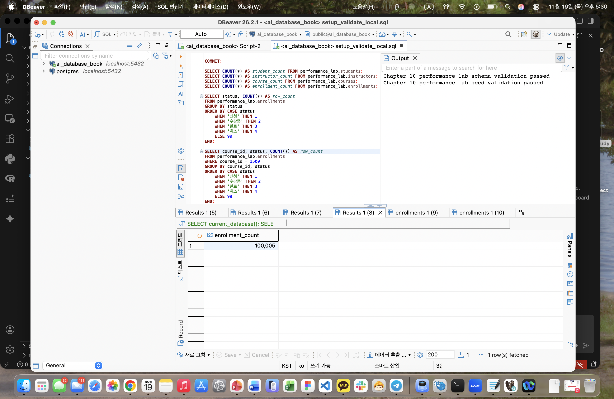
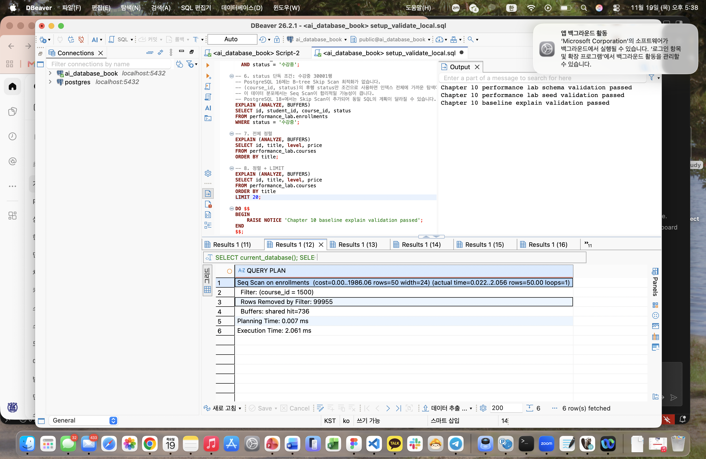
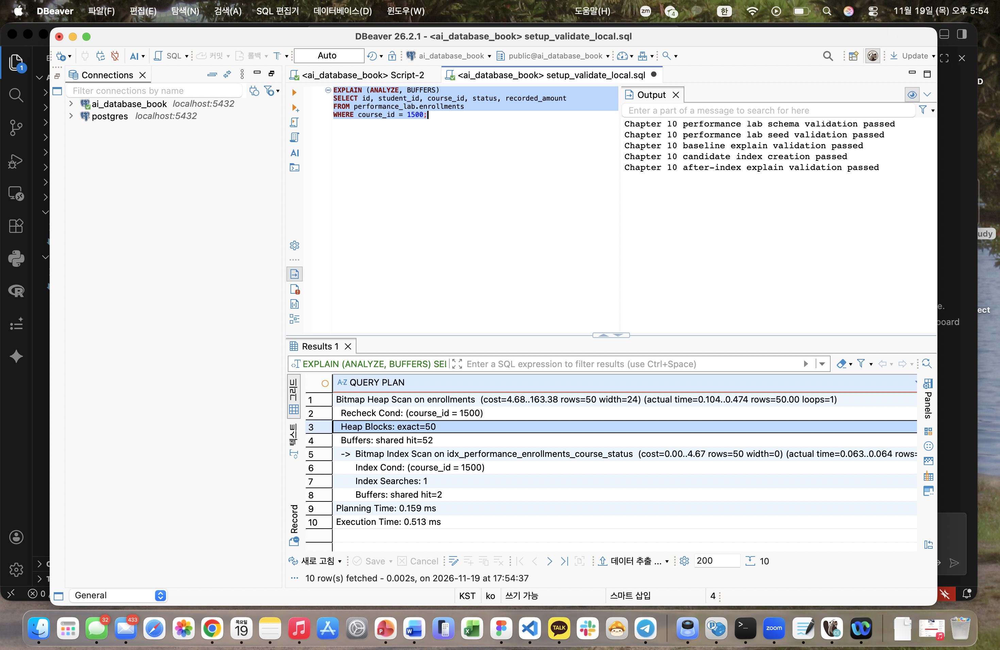

# Chapter 10 확장 실습 답안 템플릿

> **과제:** 실행 계획으로 인덱스 효과 검증하기  
> **사용 방법:** 이 파일을 내려받아 본인의 GitHub 저장소에 `chapter10_answer.md`라는 이름으로 저장한 뒤 실습하면서 바로 작성합니다.  
> **제출 방법:** LMS에는 파일을 직접 업로드하지 않고, **본인 GitHub 저장소의 `chapter10_answer.md` 파일 URL**을 제출합니다.

---

## 제출 전 주의

이 파일과 캡처 화면에는 실제 비밀번호, 전체 DB 접속 URL, API Key, 개인정보를 기록하지 않습니다.

```text
GitHub 계정 또는 별칭: gosaengchung
과제 작성일: 2026-11-17
사용한 AI 도구: GPT 6 Sol
```

---

# 1. PostgreSQL 버전과 시작 환경 확인

다음을 실행합니다.

```sql
SELECT version();
SELECT current_database();
SELECT current_user;
SELECT current_schema();
SHOW search_path;
```

| 확인 항목 | 실제 결과 | 의미 |
| --- | --- | --- |
| `current_database()` | ai_database_book | 현재 접속한 데이터베이스 이름 |
| `current_user` | postgres | 현재 데이터베이스의 소유자 이름이 postgres |
| `current_schema()` | public | 현재 위치한 데이터베이스 내 스키마를 말해줌 |
| `search_path` | public, "$user"| 어느 스키마부터 순서대로 찾아볼지 결정|
| `transaction_read_only` | off | 이 데이터베이스의 구조를 바꿀 수 있는 권한이 커져있다. (읽기 전용 모드가 off되어 있으므로) |

### PostgreSQL 버전을 기록해야 하는 이유

```text
PostgreSQL 버전에 따라 같은 SQL도 실행 계획과 성능이 달라질 수 있기 때문이다.
```

> 이 장의 자동 검증 기준은 PostgreSQL 16입니다. PostgreSQL 18 이상에서는 B-tree Skip Scan 등으로 동일 SQL의 실행 계획이 달라질 수 있습니다.

---

# 2. Chapter 07·08 기준 상태 확인

Chapter 10은 기존 `course_project`를 변경하지 않습니다.

확인 기준:

```text
students = 3
instructors = 2
courses = 3
enrollments = 5

전체 recorded_amount = 590000
활성 = 3건 / 340000
취소 제외 = 4건 / 440000
```

```text
1001 = 완료 / 100000
1004 = 취소 / 150000
1005 = 신청 / 120000
```

### 실제 확인 결과

```text
students: 3
instructors: 2
courses: 3
enrollments: 5
전체 recorded_amount: 590000
활성 신청 건수/금액: 3 / 340000
취소 제외 건수/금액: 4 / 440000
```

### 성능 실험을 기존 `course_project`에 대량 데이터를 넣지 않고 별도 스키마에서 하는 이유

```text
대량 데이터를 기존 테이블에 넣으면 앞선 실습의 행 수와 금액 집계가 달라져 기준 상태를 유지하기 어렵기 때문이다. 별도 스키마를 사용하면 기존 데이터를 보존하면서 실험용 데이터와 인덱스를 자유롭게 다룰 수 있을 것이다.
```

---

# 3. `performance_lab` 생성과 대량 데이터 확인

다음 파일을 순서대로 실행합니다.

```text
code/chapter10/01_performance_lab_schema.sql
code/chapter10/02_performance_lab_seed.sql
```

## 3-1. 생성 후 행 수

| 테이블 | 기대 행 수 | 실제 행 수 | 일치? |
| --- | ---: | ---: | --- |
| `performance_lab.students` | 10003 | 10003 | 일치 |
| `performance_lab.instructors` | 2 | 2 | 일치 |
| `performance_lab.courses` | 2003 | 2003 | 일치 |
| `performance_lab.enrollments` | 100005 | 100005 | 일치 |

## 3-2. 데이터 분포 확인

| 조건 | 기대 행 수 | 실제 행 수 | 대략적 비율 |
| --- | ---: | ---: | ---: |
| `performance5000@example.com` | 1 | 1 | 약 0.010% |
| `student_id = 5000` | 10 | 10 | 약 0.010% |
| `course_id = 1500` | 50 | 50 | 약 0.050% |
| `course_id = 1500 AND status='수강중'` | 15 | 15 | 약 0.015% |
| 전체 `status='수강중'` | 30001 | 30001 | 약 30.0% |

### 선택도가 낮은 조건과 많은 행을 반환하는 조건은 인덱스 판단에서 어떻게 다르게 볼 수 있나요?

```text
조건에 맞는 행의 비율이 낮으면 인덱스로 필요한 행만 찾아 읽는 방식이 유리할 수 있다. 
예를 들어 student_id = 5000은 전체 신청 중 10행만 조회하므로 인덱스 적용 효과를 기대할 수 있다.

반면 status = '수강중'처럼 전체의 약 30%를 반환하면 인덱스를 거쳐 많은 테이블 행을 읽는 것보다 테이블 전체를 순서대로 읽는 편이 효율적일 수 있다.
```

### 증거 화면

---

# 4. 인덱스 생성 전 기준 계획 기록

다음 파일을 실행합니다.

```text
code/chapter10/03_baseline_explain.sql
```

> **중요:** `04_create_candidate_indexes.sql`을 먼저 실행하지 않습니다. 기준 계획을 잃으면 같은 조건의 전후 비교가 어려워집니다.

최소 3개 SQL의 실행 계획을 기록합니다.

## Query A

```text
업무 질문: 이메일이 performance5000@example.com인 학생의 정보를 조회한다.
WHERE / JOIN / ORDER BY / LIMIT: WHERE email = 'performance5000@example.com' / JOIN·ORDER BY·LIMIT 없음
예상 반환 행 수: 1행
실제 반환 행 수: 실행 결과 확인 필요 (기준 데이터에서는 1행)
```

```sql
-- 대상 SQL
EXPLAIN (ANALYZE, BUFFERS)
SELECT id, name, email
FROM performance_lab.students
WHERE email = 'performance5000@example.com';
```

| 관찰 항목 | 기록 |
| --- | --- |
| 주요 Scan/계획 노드 | UNIQUE 자동 인덱스를 이용한 Index Scan 예상, 실제 계획 확인 필요 |
| estimated rows | 실행 계획의 `rows` 확인 필요 |
| actual rows | 실행 계획의 `actual rows` 확인 필요, 기준상 1 |
| Filter | 이메일 조건이 Index Cond로 처리되면 별도 Filter 없음 |
| Index Cond | `(email = 'performance5000@example.com'...)` 예상 |
| Buffers hit/read | 실행 결과 확인 필요 |
| Planning Time | 실행 결과 확인 필요 |
| Execution Time | 실행 결과 확인 필요 |

## Query B

```text
업무 질문: 제목이 성능 테스트 강의 00500인 강의를 조회한다.
WHERE / JOIN / ORDER BY / LIMIT: WHERE title = '성능 테스트 강의 00500' / JOIN·ORDER BY·LIMIT 없음
예상 반환 행 수: 1행
실제 반환 행 수: 실행 결과 확인 필요 (기준 데이터에서는 1행)
```

| 관찰 항목 | 기록 |
| --- | --- |
| 주요 Scan/계획 노드 | title 인덱스가 없으므로 Seq Scan 예상 |
| estimated rows | 실행 계획의 `rows` 확인 필요 |
| actual rows | 실행 계획의 `actual rows` 확인 필요, 기준상 1 |
| Filter | `(title = '성능 테스트 강의 00500'...)` 예상 |
| Index Cond | 없음 예상 |
| Buffers hit/read | 실행 결과 확인 필요 |
| Execution Time | 실행 결과 확인 필요 |

## Query C

```text
업무 질문: 학생 5000의 신청 내역을 학생 이름과 강의 제목을 포함하여 조회한다.
WHERE / JOIN / ORDER BY / LIMIT: WHERE e.student_id = 5000 / students·courses와 ID로 JOIN / ORDER BY·LIMIT 없음
예상 반환 행 수: 10행
실제 반환 행 수: 실행 결과 확인 필요 (기준 데이터에서는 10행)
```

EXPLAIN (ANALYZE, BUFFERS)
SELECT
    e.id,
    s.name AS student_name,
    c.title AS course_title,
    e.status,
    e.recorded_amount
FROM performance_lab.enrollments AS e
JOIN performance_lab.students AS s
    ON s.id = e.student_id
JOIN performance_lab.courses AS c
    ON c.id = e.course_id
WHERE e.student_id = 5000;

### `cost`와 실제 실행 시간이 같은 개념이 아닌 이유

```text
cost는 데이터베이스가 여러 실행 방법을 비교하기 위해 계산한 예상 작업 비용으로, 밀리초 단위의 시간이 아니다. 실제 실행 시간은 SQL을 실행하면서 측정한 값이며 캐시 상태, 디스크 접근, 서버 부하 등의 영향을 받는다. 따라서 cost 숫자를 실행 시간으로 해석하면 안 된다.
```

### `EXPLAIN ANALYZE`는 실제 SQL을 실행한다는 점을 왜 기억해야 하나요?

```text
실행 계획만 예상해서 보여주는 것이 아니라 SQL을 실제로 실행하고 처리 행 수와 시간을 측정하기 때문이다. SELECT도 자원을 사용하며, INSERT·UPDATE·DELETE에 사용하면 데이터가 실제로 변경된다. 따라서 실행할 SQL의 종류와 영향을 확인하고, 변경 실험이라면 트랜잭션과 ROLLBACK을 준비해야 한다.
```

### 증거 화면

`여기에 대표 기준 실행 계획을 삽입하세요.`

---

# 5. 후보 인덱스를 만들기 전에 이유 작성

본문 실험 후보는 다음 세 개입니다.

```text
idx_performance_courses_title
idx_performance_enrollments_student_id
idx_performance_enrollments_course_status
```

각 인덱스의 이유를 먼저 작성합니다.

| 후보 인덱스 | 대응 조회 패턴 | 예상 이점 | 컬럼 순서 이유 | 예상 비용/단점 |
| --- | --- | --- | --- | --- |
| `idx_performance_courses_title` | `WHERE title = '...'`, `ORDER BY title`, `ORDER BY title LIMIT 20` | 제목 검색 범위를 줄이고, 제목순 조회에서 별도 정렬을 줄일 수 있음. LIMIT 조회는 앞부분만 읽고 종료 가능 | title 단일 컬럼으로 제목 검색과 정렬에 대응 | 저장 공간과 INSERT·DELETE·title 변경 시 유지 비용 발생. 전체 행 정렬 조회에서는 Seq Scan과 정렬이 더 유리할 수 있음 |
| `idx_performance_enrollments_student_id` | `WHERE student_id = 5000` 및 해당 학생의 신청 JOIN | 전체 100005행을 훑는 대신 해당 학생의 신청 10행을 빠르게 찾을 수 있음 | student_id 단일 컬럼으로 학생별 신청 검색에 대응 | 저장 공간과 데이터 변경 시 유지 비용 발생. 특정 학생의 신청이 매우 많으면 효과가 줄어들 수 있음 |
| `idx_performance_enrollments_course_status` | `WHERE course_id = 1500`, `WHERE course_id = 1500 AND status = '수강중'` | 강의별 50행 또는 특정 강의·상태의 15행으로 탐색 범위를 좁힐 수 있음 | course_id를 앞에 두어 강의 단독 조건과 강의·상태 복합 조건에 모두 대응 | 두 컬럼 저장에 따른 공간과 유지 비용 발생. status만 사용하는 조회에서는 효율이 제한될 수 있음 |

### “중요한 컬럼이므로 인덱스를 만든다”는 설명이 부족한 이유

```text
업무상 중요한 컬럼이라도 실제 데이터베이스 구조와 너무 다를 경우 인덱스의 이점이 작을 수 있음. 
인덱스는 저장 공간과 데이터 변경 시 유지 비용도 발생하므로, 어떤 조회를 얼마나 자주 수행하고 전체 중 몇 행을 반환하는지 근거로 설계해야 함
```

### `(course_id, status)`와 `(status, course_id)`가 항상 같은 효과가 아닌 이유

```text
복합 B-tree 인덱스는 앞쪽 컬럼부터 정렬되므로 컬럼 순서에 따라 효율적으로 찾을 수 있는 범위가 달라지기 때문 
```

---

# 6. 후보 인덱스 생성

다음을 실행합니다.

```text
code/chapter10/04_create_candidate_indexes.sql
```

생성 후 확인:

```text
후보 인덱스 수: 3
전체 인덱스 수: 9
```

본문 기준:

```text
자동 인덱스 = 6
후보 인덱스 = 3
전체 인덱스 = 9
```

### PRIMARY KEY나 UNIQUE가 이미 인덱스를 만들 수 있는데 같은 목적의 인덱스를 또 만들면 어떤 문제가 생기나요?

```text
PRIMARY KEY나 UNIQUE가 이미 만든 인덱스와 같은 컬럼·순서의 인덱스를 추가하면 조회 성능은 거의 개선되지 않으면서 저장 공간을 더 사용하게 된다. 또한 DML 시 유지해야 할 인덱스가 늘어 쓰기 비용도 커질 수 있다. 따라서 새 인덱스를 만들기 전에 기존 인덱스가 해당 조회를 이미 지원하는지 확인해야 한다.
```

---

# 7. 같은 SQL로 인덱스 후 재측정

다음 파일을 실행합니다.

```text
code/chapter10/05_after_index_explain.sql
```

Chapter 4에서 기록한 **동일 SQL**을 비교합니다.

## Query A 전후 비교

| 항목 | Before | After | 해석 |
| --- | --- | --- | --- |
| 주요 계획 노드 | Seq Scan | Bitmap Heap Scan → Bitmap Index Scan | 전체 순차 탐색에서 `idx_performance_enrollments_course_status`를 이용하는 방식으로 변경 |
| actual rows | 50 | 50 | 전후 모두 조건에 맞는 50행 반환 |
| Buffers hit/read | hit=736 / read=0 | hit=52 / read=0 | 공유 버퍼 접근이 736회에서 52회로 약 92.9% 감소 |
| Execution Time | 2.061 ms | 0.513 ms | 이번 측정에서 실행 시간이 약 75.1% 감소 |
| Index Cond | 없음 | `course_id = 1500` | 복합 인덱스의 첫 번째 컬럼으로 탐색 범위를 제한 |

```text
결과 행이 동일했는가: 전후 반환 행 수는 모두 50행으로 동일
읽은 버퍼가 줄었는가: 줄었다. shared hit가 736에서 52로 감소했고, shared read는 전후 모두 0
계획이 바뀌었는가: Seq Scan에서 복합 인덱스를 사용하는 Bitmap Index Scan과 Bitmap Heap Scan으로 변경되었다.
실행 시간 한 번만으로 결론낼 수 있는가: 없다. 이번에는 버퍼 접근량과 실행 시간이 모두 감소했지만, 캐시와 서버 부하의 영향을 고려해 반복 측정해야 한다.
```

### `Index Scan`으로 바뀌었다는 사실만으로 성공이라고 할 수 없는 이유

```text
인덱스를 사용하더라도 많은 행을 조회하면 인덱스와 테이블을 오가는 비용 때문에 Seq Scan보다 느릴 수 있기 때문이다. 따라서 계획 이름만 보지 않고 결과가 동일한지, 버퍼 접근량과 실행 시간이 줄었는지 함께 확인해야 한다. 실행 시간은 캐시와 서버 부하의 영향도 받으므로 한 번의 측정만으로 성공을 판단하면 안 된다.
```

### 증거 화면


---

# 8. `status` 단독 조회와 Seq Scan 해석

전체 `status = '수강중'`은 약 30%의 행을 반환합니다.

```text
예상 행 수 = 30001
실제 행 수 = 30001
주요 계획 노드 = Seq Scan
```

### 인덱스가 존재해도 PostgreSQL이 Seq Scan을 선택할 수 있는 이유

```text
조회할 데이터가 많을 경우 인덱스를 사용하는 것보다 전체 테이블을 순서대로 읽는 비용이 작다고 판단할 수 있음
```

### “Seq Scan = 나쁜 계획”이라고 단정하면 안 되는 이유

```text
많은 행을 읽어야 하거나 테이블이 작다면 전체를 순서대로 읽는 방식이 더 효율적일 수 있음
```

### PostgreSQL 16과 18 이상에서 복합 B-tree 후행 컬럼 조건의 계획이 다를 수 있는 이유

```text
PostgreSQL 18에는 B-tree Skip Scan이 추가되어 앞쪽 컬럼에 조건이 없어도 후행 컬럼 조건을 활용해 인덱스의 일부 구간을 건너뛰며 탐색할 수 있기 때문
```

---

# 9. `ORDER BY`와 `LIMIT`에서 인덱스 관찰

`ORDER BY title`과 `ORDER BY title LIMIT 20` 계획을 비교합니다.

```text
ORDER BY title 계획:
idx_performance_courses_title을 사용하는 Index Scan으로 2003행을 제목순으로 조회했다. 별도 Sort 노드는 없었으며, Buffers는 shared hit=49, Execution Time은 0.540 ms였다.

ORDER BY title LIMIT 20 계획:
Limit 아래에서 idx_performance_courses_title을 사용하는 Index Scan이 실행됐다. 실제로 20행만 읽고 종료했으며, 별도 Sort 노드는 없었다. Buffers는 shared hit=3, Execution Time은 0.062 ms였다.
```

### LIMIT이 있을 때 PostgreSQL이 전체 정렬보다 인덱스 순서를 활용하는 것이 유리할 수 있는 이유

```text
LIMIT을 걸 경우 조회해야 할 행의 수가 제한되기 때문
```

### 실제 계획에서 Sort 노드 또는 Index Scan을 어떻게 확인했나요?

```text
두 실행 계획 모두 Index Scan using idx_performance_courses_title이 표시되고 Sort 노드는 없어 인덱스 순서로 정렬을 처리했음을 확인
```

---

# 10. 인덱스 검토

다음을 실행합니다.

```text
code/chapter10/06_index_review.sql
```

## 10-1. 인덱스별 판단

| 인덱스 | 크기/사용 관찰 | 유지 / 보류 / 제거 | 판단 근거 |
| --- | --- | --- | --- |
| `idx_performance_courses_title` | valid·ready 정상. 제목 검색과 정렬에서 사용 확인. 크기는 미확인 | 유지 | 제목 검색과 정렬에 활용됐으며, LIMIT 조회에서 20행만 읽고 종료함 |
| `idx_performance_enrollments_student_id` | valid·ready 정상. 크기·사용 통계와 실제 사용 계획은 미확인 | 보류 | 학생별 신청 조회를 지원하는 구조지만 실제 성능 효과는 추가 확인 필요 |
| `idx_performance_enrollments_course_status` | valid·ready 정상. 강의별 조회에서 사용됐으며 shared hit가 736→52로 감소. 크기는 미확인 | 유지 | 복합 인덱스의 첫 컬럼인 course_id만으로도 검색에 활용됐고 버퍼 접근량이 감소함 |

### `idx_scan = 0`이라는 이유 하나만으로 인덱스를 삭제하면 안 되는 이유

```text
사용 통계가 초기화됐거나 관찰 기간이 짧아 아직 사용 기록이 없을 수 있기 때문
```

### 외래키 자식 컬럼 인덱스가 무결성 자체의 필수 조건은 아니지만 성능상 필요할 수 있는 이유

```text
외래키 제약조건은 자식 컬럼에 인덱스가 없어도 잘못된 참조를 막는다. 다만 부모 데이터를 삭제하거나 참조 키를 변경할 때 관련 자식 행을 찾아야 하므로, 인덱스가 없으면 자식 테이블 전체를 탐색할 수 있다. 자식 컬럼 인덱스는 이러한 확인과 외래키를 이용한 조회·JOIN의 성능을 높이는 데 도움이 될 수 있다.
```

### 인덱스를 많이 만들었을 때 생기는 쓰기·저장 비용

```text
1. 인덱스마다 별도 저장 공간을 사용하고 메모리 캐시도 차지 
2. INSERT 시에는 관련 인덱스에 항목을 추가하고, 인덱스 대상 컬럼을 UPDATE하면 인덱스도 갱신 필요
3. DELETE로 불필요해진 인덱스 항목은 이후 정리 작업이 필요
```

---

# 11. 자동 완료 게이트

다음을 실행합니다.

```text
code/chapter10/07_result_validation.sql
```

```text
최종 검증 결과: Chapter 10 performance result validation passed 및 핵심 내용 유지
```

검증할 핵심 내용:

```text
performance_lab 기준 행 수 유지
조회 결과 행 수 유지
후보 인덱스 3개 존재
course_project 기준 상태 유지
```

### 실행 계획 비교와 별도로 결과 행 동일성을 검증해야 하는 이유

```text
실행 계획은 데이터를 어떤 방식으로 조회하는지 보여줄 뿐, 전후 결과가 같은지까지 보장하지 않기 때문이다. 조회가 빨라져도 필요한 행이 빠지거나 중복되면 올바른 개선이 아니다. 따라서 같은 SQL과 데이터 조건에서 결과를 별도로 비교해야 하며, 행 수가 같더라도 내용은 다를 수 있으므로 필요하면 실제 반환값까지 확인해야 한다.
```

---

# 12. 인덱스 만능론 반박

다음 주장 중 **두 개**를 골라 본문과 실제 실행 계획을 근거로 반박합니다.

```text
A. 인덱스는 많을수록 좋다.
B. 인덱스를 만들었는데 Seq Scan이면 실패다.
C. 모든 FK에는 무조건 같은 방식의 인덱스를 만든다.
D. 실행 시간이 한 번이라도 빨라졌으면 효과가 입증됐다.
E. 선택도가 낮으면 무조건 Index Scan이 나온다.
```

## 주장 1

```text
선택한 주장: A. 인덱스는 많을수록 좋다.

나의 반박: 조회에 거의 쓰이지 않는 인덱스까지 추가하면 저장 공간과 쓰기 비용만 늘어날 수 있다.

실행 계획에서 확인한 근거: title 인덱스를 사용한 전체 정렬은 2003행을 읽고 shared hit=49였지만, LIMIT 20 조회는 20행만 읽고 shared hit=3이었다. 같은 인덱스라도 조회 방식에 따라 처리량이 달라졌으므로, 실제 조회 패턴을 기준으로 필요성을 판단해야 한다.
```

## 주장 2

```text
선택한 주장: D. 실행 시간이 한 번이라도 빨라졌으면 효과가 입증됐다.

나의 반박: 실행 시간이 줄었다는 것은 좋은 신호지만, 그 차이가 전부 인덱스 때문이라고 단정하기는 어렵다고 생각한다. 같은 조건에서 반복 측정하고, 실행 계획과 버퍼 접근량도 함께 봐야 한다.

실행 계획에서 확인한 근거: course_id = 1500 조회는 인덱스 생성 전 2.061 ms에서 생성 후 0.513 ms로 빨라졌다. 동시에 Seq Scan이 Bitmap Heap Scan과 Bitmap Index Scan으로 바뀌었고, shared hit도 736에서 52로 줄었다. 따라서 이번에는 시간 감소뿐 아니라 읽기 작업이 줄었다는 근거도 확인했지만, 정확한 개선 폭은 반복 측정이 필요하다.
```

---

# 13. 개인 프로젝트 조회 패턴과 인덱스 후보

Chapter 07~09에서 발전시킨 개인 프로젝트를 사용합니다.

최소 2개의 **실제 반복 조회 질문**을 먼저 만듭니다.

| ID | 반복 조회 질문 | WHERE | JOIN | ORDER BY/LIMIT | 예상 반환 비율 | 후보 인덱스 |
| --- | --- | --- | --- | --- | --- | --- |
| P10-Q01 | 분석한 종목의 최근 1년 주가 흐름은 어땠는가? | `stock_id = :stock_id` 및 거래일 범위 | 시세와 종목 정보를 `stock_id`로 JOIN | `trade_date ASC` | 약 625만 건 중 약 250건, 약 0.004% | `stock_prices(stock_id, trade_date)` |
| P10-Q02 | 특정 거래일에 거래량이 가장 많았던 종목 20개는 무엇인가? | `trade_date = :target_date` | 시세와 종목 정보를 `stock_id`로 JOIN | `volume DESC, stock_id ASC LIMIT 20` | 날짜 조건 약 2500건으로 약 0.04%, 최종 20건은 약 0.00032% | `stock_prices(trade_date, volume DESC, stock_id)` |
## 후보 1

```text
후보 인덱스: uq_stock_prices_stock_date

컬럼 순서: stock_id, trade_date

이 조회에 도움이 될 것으로 예상한 이유: 픽로그에서 분석과 복기를 할 때 특정 종목의 과거 가격 흐름을 반복해서 확인할 것으로 생각했다. 종목으로 먼저 범위를 좁힌 뒤 필요한 거래일 구간만 읽고, 날짜순으로 반환하는 데 도움이 될 수 있다.

쓰기/저장 비용: 일별 시세를 추가할 때마다 인덱스도 갱신해야 하고, 전체 시세 행에 대한 키를 저장할 공간이 필요하다.

현재 바로 적용 / 후보로 보류: 후보로 보류. 먼저 기존 PK·UNIQUE 구성을 확인한다. 종목과 거래일에 이미 같은 순서의 인덱스가 있으면 추가하지 않는다. 없다면 종목별 하루 한 행이라는 규칙을 보장하는 UNIQUE 제약조건으로 구현하는 방안도 검토한다.
```

## 후보 2

```text
후보 인덱스: idx_stock_prices_date_volume

컬럼 순서: trade_date, volume DESC, stock_id

이 조회에 도움이 될 것으로 예상한 이유: 사용자가 분석할 종목을 탐색할 때 특정 거래일의 거래량 상위 종목을 확인할 수 있다. 거래일로 범위를 좁힌 뒤 거래량순으로 앞의 20행을 읽으면 별도 정렬과 처리량을 줄일 수 있을 것으로 예상했다. 거래량이 같은 경우에도 순서가 일정하도록 stock_id를 마지막에 둔다.

쓰기/저장 비용: 시세를 적재하거나 거래량을 정정할 때 인덱스 유지 비용이 발생하고, 세 컬럼을 저장할 추가 공간이 필요하다.

현재 바로 적용 / 후보로 보류: 후보로 보류. 특정 날짜의 데이터는 약 2500행에 불과하므로, 후보 1의 인덱스와 별개로 이 인덱스까지 유지할 만큼 조회 개선이 큰지 확인해야 한다.
```

### 개인 프로젝트 데이터가 너무 적어 성능 검증이 어렵다면

```text
필요한 데이터 규모: 관심 종목 10개의 시세를 1분 간격으로 저장한다고 가정한다. 하루 390회, 20거래일 기준 약 78000행으로 시작하고 필요하면 기간을 늘린다.

필요한 데이터 분포: 종목별 시각당 한 행을 저장하고 가격과 1분간 거래량을 다르게 구성한다. 거래가 없는 구간과 수집이 누락된 구간을 구분한다.

비교할 SQL: 특정 종목의 하루 시세를 시간순으로 조회하는 SQL과 특정 종목의 최신 시세 20개를 조회하는 SQL을 비교한다.

비교할 지표: 결과 내용과 순서의 동일성, Scan 방식, Sort 유무, Buffers hit/read, 반복 측정한 Execution Time, 인덱스 크기

현재 판단 상태: 후보. (stock_id, observed_at) 복합 인덱스를 우선 검토하되 기존 PK·UNIQUE와 중복되는지 확인하고 실제 계획으로 효과를 검증한다.
```

> 작은 데이터에서 Index Scan이 나오지 않는다고 억지로 설정을 바꾸어 특정 계획을 강제하지 않습니다.

---

# 14. AI를 실행 계획 리뷰어로 활용

AI에게 인덱스를 바로 추천하게 하지 않고 실제 실행 계획과 조회 문맥을 제공합니다.

## 14-1. AI에게 전달한 정보

```text
업무 질문:
업무 질문: 특정 강의의 신청 내역을 조회할 때 복합 인덱스가 실제로 읽기 작업을 줄였는지 확인하고 싶다.

PostgreSQL 버전: 실제 server_version 조회값을 별도 기재해야 한다. 교재 검증 기준은 PostgreSQL 16이다.

테이블 행 수: performance_lab.enrollments 100005행

데이터 분포: course_id = 1500인 신청은 50행으로 전체의 약 0.05%이다. 전체 status = '수강중'인 신청은 30001행으로 약 30%이다.

기존 인덱스: 생성 전에는 enrollments의 기본키 인덱스가 있었고, 이후 student_id 단일 인덱스와 (course_id, status) 복합 인덱스를 추가했다.

SQL:
SELECT id, student_id, course_id, status, recorded_amount
FROM performance_lab.enrollments
WHERE course_id = 1500;

EXPLAIN (ANALYZE, BUFFERS) 핵심 결과:
Before: Seq Scan / actual rows=50 / shared hit=736 / Execution Time=2.061 ms
After: Bitmap Heap Scan과 Bitmap Index Scan / actual rows=50 / shared hit=52 / Execution Time=0.513 ms
사용 인덱스: idx_performance_enrollments_course_status
Index Cond: course_id = 1500
```

## 14-2. AI 제안 검토

| AI 제안 | 수용 / 수정 / 보류 / 거절 | 실제 계획/데이터 근거 | 최종 판단 |
| --- | --- | --- | --- |
| `(course_id, status)` 복합 인덱스 유지 | 수용 | course_id 단독 조건에서도 사용됐고 shared hit가 736→52로 감소함 | 이번 조회에서 읽기 감소를 확인하여 유지 |
| 실행 시간과 함께 계획·Buffers를 비교 | 수용 | 실행 시간은 2.061→0.513 ms로 감소했고 탐색 방식과 버퍼 접근량도 바뀜 | 개선 근거는 확인했지만 정확한 개선 폭은 반복 측정 필요 |
| 픽로그 시세 테이블에 `(stock_id, observed_at)` 인덱스 적용 | 보류 | 종목별 기간 조회와 최신 20개 조회에 적합한 구조지만 실제 계획은 없음 | 기존 인덱스와 중복 여부 및 실험 결과를 확인한 뒤 적용 |

### AI가 제안한 인덱스 중 만들지 않기로 한 것이 있다면 이유

```text
처음 검토했던 픽로그의 거래 시각·거래량 복합 인덱스는 현재 설계에서 제외했다. 관심 종목을 10개로 줄이면 특정 시각의 비교 대상도 약 10행이라 별도 정렬 비용이 작을 것으로 생각했기 때문이다. 우선 종목별 시세 조회에 집중하고, 실제 사용에서 필요성이 확인되면 다시 검토하려고 한다.
```

### AI가 PostgreSQL 버전이나 데이터 분포를 무시하고 단정한 내용이 있었나요?

```text
AI는 특정 계획을 주로 예상으로 표현했지만, 실제 서버 버전을 확인하기 전에 교재 기준인 PostgreSQL 16을 중심으로 설명했다. 또한 처음 제안한 주식 데이터 규모는 내 로컬 실험 목적에 비해 컸다. 그래서 실제 환경과 데이터 규모를 먼저 정하고, 예상 계획과 측정 결과를 구분해야 한다고 판단했다.
```

### AI가 만든 인덱스 제안을 실제 계획 없이 채택하면 위험한 이유

```text
조회 조건에 맞아 보이는 인덱스라도 기존 인덱스와 중복되거나 실제로는 사용되지 않을 수 있기 때문이다. 픽로그처럼 시세를 계속 추가하는 구조에서는 인덱스를 유지하는 쓰기 비용도 누적된다. 따라서 제안은 후보로 받아들이고, 조회에서 줄어든 작업이 저장 공간과 적재 비용을 감수할 만큼 유용한지 확인해야 한다.
```

---

# 15. 최종 성찰

아래 문장은 본인의 말로 작성합니다.

```text
1. 인덱스가 필요한지 판단할 때 가장 먼저 확인할 것은
   사용자가 어떤 조건으로 데이터를 반복 조회하고, 그 조건이 전체 중 얼마나 적은 행을 찾는지이다.

2. 같은 SQL의 인덱스 전후를 비교할 때 통제해야 할 조건은
   SQL과 검색값, 데이터 내용, 테이블 통계, 서버 설정이며, 캐시와 부하 차이도 기록하고 고려해야 한다.

3. Seq Scan이 항상 나쁜 것이 아닌 이유는
   많은 행을 반환하거나 테이블이 작으면 인덱스를 거치는 것보다 전체를 순서대로 읽는 편이 효율적일 수 있기 때문이다.

4. 실행 시간 한 번보다 계획과 Buffers를 함께 보는 이유는
   우연히 빨라진 것인지 실제로 데이터를 찾고 읽는 작업이 줄어든 것인지 구분하기 위해서이다.

5. 내 개인 프로젝트에서 아직 인덱스를 보류한 후보가 있다면 그 이유는
   종목별 시세 조회용 인덱스가 구조상 적합해 보여도 실제 데이터와 실행 계획에서 효과를 검증하지 못했고, 기존 PK·UNIQUE와의 중복도 확인해야 하기 때문이다.
```

---

# 16. 제출 체크리스트

- [x] `chapter10_answer.md`를 본인 저장소에 만들었다.
- [x] PostgreSQL 버전을 기록했다.
- [x] Chapter 07·08 기준 상태를 확인했다.
- [x] `performance_lab`의 10003 / 2 / 2003 / 100005 기준을 확인했다.
- [x] `03_baseline_explain.sql`을 후보 인덱스 생성 전에 실행했다.
- [x] 기준 실행 계획을 최소 3개 기록했다.
- [x] 후보 인덱스 3개의 근거를 먼저 작성했다.
- [x] 동일 SQL의 인덱스 전후 계획을 비교했다.
- [x] 실행 시간뿐 아니라 Scan, actual rows, Buffers, Index Cond를 확인했다.
- [x] `status` 단독 조건의 계획을 해석했다.
- [x] `ORDER BY`와 `LIMIT` 계획을 확인했다.
- [x] 인덱스 만능론 주장 2개를 반박했다.
- [x] `07_result_validation.sql`로 최종 상태를 확인했다.
- [x] 개인 프로젝트의 반복 조회 2개와 인덱스 후보를 작성했다.
- [x] AI 제안을 실제 실행 계획과 비교했다.
- [x] 핵심 캡처 3~4장만 넣었다.
- [x] 캡처에 비밀번호·개인정보가 없다.
- [x] GitHub 웹에서 Markdown과 이미지가 정상적으로 보인다.
- [x] 최종 답안을 commit/push했다.

---

# 17. LMS 제출 URL

아래 형식의 **본인 GitHub 파일 URL**을 LMS에 제출합니다.
내 제출 URL:

```text
https://github.com/gosaengchung/ai-database-study/blob/main/assignments/chapter10/chapter10_answer.md
```

> 저장소 메인 URL, 교수자 템플릿 URL, Raw URL이 아니라 **작성 완료된 본인 `chapter10_answer.md` 파일 화면 URL**을 제출합니다.
